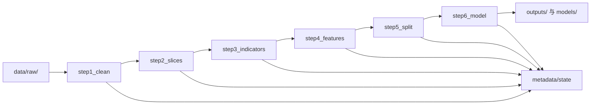

# 10_architecture

## 总述

本仓库的内核是一个 execution kernel：step1~step6 的语义固定，新增样本族或扩展能力时只在外层配置、适配器、脚手架或可选模块上扩展，不改主线步骤的基本职责。

## 主线清单（11 文件）

主线模块固定为以下 11 个文件：

1. `config.py`
2. `state.py`
3. `utils.py`
4. `runner.py`
5. `step1_clean.py`
6. `step2_slices.py`
7. `step3_indicators.py`
8. `step4_features.py`
9. `step5_split.py`
10. `step6_model.py`
11. `eval_summary.py`

这些文件共同定义了从原始输入到模型输出的最小闭环。

## 支线与可选能力

- `pipeline/branches/indicators_v3.py`：历史命名保留，用于通用技术指标扩展
- `pipeline/ensemble/bagging.py`：bagging 集成编排能力
- `pipeline/adapters/sample_family.py`：输入数据契约与展示入口
- `pipeline/_analysis_report.py`：即时分析报告辅助
- `pipeline/monitoring.py`：过程监控与摘要辅助

> `pipeline/branches/indicators_v3.py` 的文件名与 `profile: v3_enriched` 取值是历史命名，
> 其实现为通用技术指标扩展（MACD / Boll %B / OBV / KDJ），与 v3 谱系无强绑定。

## 模块职责表

| 模块 | 职责 | 暴露符号 |
| :--- | :--- | :--- |
| `pipeline/config.py` | 配置中心、路径构建、YAML 加载、参数对象定义 | `Paths`、`PipelineParams`、`build_paths()`、`ensure_directories()`、`load_params()` |
| `pipeline/state.py` | 状态机、幂等跳过、前置校验、state 写回 | `load_state()`、`save_state()`、`update_step_state()`、`require_previous_step()` |
| `pipeline/utils.py` | 共用工具、日志入口、数值清洗、确定性分块 | `file_suffix()`、`log_step_start()`、`replace_inf_and_fill()`、`chunk_by_ids()` |
| `pipeline/runner.py` | 单步编排入口，连接 CLI 与 step 实现 | `run_step()` |
| `pipeline/step1_clean.py` | 原始持仓与日线输入的清洗、标准化与落盘 | `compute_step1()` |
| `pipeline/step2_slices.py` | 样本切片、非交易密度、冒烟采样 | `compute_step2()` |
| `pipeline/step3_indicators.py` | 手工技术指标生成与 profile 路由 | `compute_step3()` |
| `pipeline/step4_features.py` | tsfresh 提取、列名清洗、训练集内特征筛选 | `compute_step4()` |
| `pipeline/step5_split.py` | 手工特征拼接、标签处理、数据集划分与缓冲带校验 | `compute_step5()` |
| `pipeline/step6_model.py` | LightGBM 训练、预测输出、评估与入模特征登记 | `compute_step6()` |
| `pipeline/eval_summary.py` | 即时评估摘要、排序/分层检查、泄露辅助诊断 | `build_eval_summary()` 等 |
| `pipeline/adapters/sample_family.py` | 展示 holding/datebar 的输入契约，帮助新样本族接入 | `--show-contract` CLI |
| `pipeline/branches/indicators_v3.py` | 可选指标扩展，不改变主线 step 语义 | 扩展指标计算函数 |
| `pipeline/ensemble/bagging.py` | bagging lab 与 ensemble 的编排、聚合与报告输出 | `run_bagging_experiment()` |

## 分层结构

可以把内核理解为四层：

1. **入口层**：`run_experiment_pipeline.py`、`run_bagging_experiment.py`
2. **配置与状态层**：`config.py`、`state.py`
3. **执行层**：`runner.py` + `step1_clean.py` ~ `step6_model.py`
4. **扩展与辅助层**：`utils.py`、`eval_summary.py`、`adapters/`、`branches/`、`ensemble/`

各层关系如下：

- 入口层只负责解析参数并调用编排器
- 配置与状态层提供稳定机制，不承载实验结论
- 执行层负责真正的数据加工与建模
- 扩展与辅助层负责能力增强，但不重写主线契约

## 数据流

## 关键不变式

### 1. step 语义不变

step1~step6 的职责边界固定；新增样本族只能通过配置、输入数据和可选扩展改变行为，不应把谱系特例直接写进主线步骤。

### 2. 输入契约前置

任何新样本族都先由 `pipeline/adapters/sample_family.py --show-contract` 对齐 holding / datebar 契约，然后再跑 step1。

### 3. 状态驱动执行

后续步骤只有在前置步骤 `completed` 且 `checks_passed=true` 时才能继续；这既是执行保障，也是重跑/恢复机制的基础。

### 4. 路径生成中心化

所有版本化路径都应由 `PipelineParams` 与路径构建函数集中生成，避免各脚本各自拼接目录结构。

### 5. 扩展能力隔离

指标扩展、bagging 集成与分析工具可以复用主线产物，但不应反向侵入 step 语义本身。

## 什么时候该改哪里

| 诉求 | 优先修改位置 |
| :--- | :--- |
| 新样本族接入 | `configs/`、`design/`、`pipeline/adapters/sample_family.py` |
| 调整主线参数 | `configs/default.yaml` 或对应实验 YAML |
| 扩展手工指标 | `pipeline/step3_indicators.py` 或 `pipeline/branches/indicators_v3.py` |
| 调整 tsfresh 提取/筛选 | `pipeline/step4_features.py` |
| 调整切分与缓冲带逻辑 | `pipeline/step5_split.py` |
| 增强模型训练/评估 | `pipeline/step6_model.py`、`pipeline/eval_summary.py` |
| 增加编排型实验 | `pipeline/ensemble/bagging.py` 与对应模板配置 |

## 为什么文档强调“只在外层扩展”

因为 execution kernel 的最大价值在于：

- 让不同样本族共享同一套防泄漏与可复现机制
- 让验证、收尾、回放工具共享同一套输出契约
- 让内核改进可以从单一样本族回灌到模板，而不是在多处分叉

因此，新增能力时优先考虑：

1. 是否能通过配置字段控制；
2. 是否能通过额外工具或支线模块实现；
3. 是否真的需要改动主线 step 的职责定义。