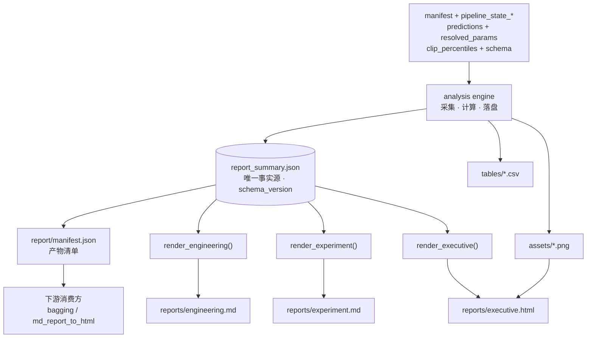
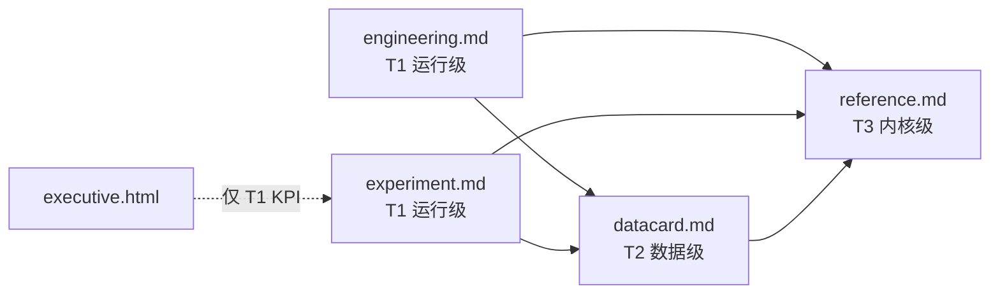

# v1.1.1 报告重构设计（实施规范）

> 版本: v1.1.1 目标设计（v1.1.0 之后的首个迭代）
> 日期: 2026-11-13
> 适用仓库: `ashare_signal_pipeline`（本仓库即内核模板，无需回灌）
> 读者: 工程实施 agent / 复核人
> 权威约束: `AGENTS.md`、`docs/01_pipeline_contract.md`
> 上游基线: tag `v1.1.0`（本设计**不修改** step1–step6 任何行为，只重构报告层）
> 计划分支: `refactor/v1.1.1`（**M5 收尾并打 `v1.1.0` tag 之后再开**）
> 状态: 设计稿，待评审（含 §6.9 待定项）

---

## 阅读方式（先看这一节）

| 角色 | 只读这些章节 | 说明 |
| :--- | :--- | :--- |
| 评审人 | §0 · §4 · §5.1–5.2 · §6 · §6.9 | 决策点集中在 §5 与 §6 |
| 实施 agent | §1 · §2 · §3 · §4 · §7 · §8 | §7 是唯一施工顺序权威 |
| 只想确认"报告长什么样" | §4 · §6 | 两节即可 |

跨章节不变约束只有两条：**§2.3 单一事实源**、**§4.4 禁止内容清单**。

---

## 0. 目标与范围

### 0.1 一句话目标

在**不改动任何计算逻辑**的前提下，把当前"一份大杂烩 Markdown + 一份混装 HTML"拆成**三份受众明确的报告**，并把报告生成从"文件名即契约"改为"事实表 + 产物清单契约"。

### 0.2 现状问题

| 编号 | 问题 | 证据 |
| :--- | :--- | :--- |
| P1 | 单份 Markdown 8 章混装工程与实验内容 | `analyze_experiment_results.py` 的 `render_markdown_report()` 共 436 行；§2.1「不同 step 的性能与瓶颈」属工程，§4–§7 属实验 |
| P2 | 领导版含工程细节 | `render_leadership_html()` 215 行，含「3. 不同 Step 的性能」「4. 结果图总览」 |
| P3 | 缺少 v1.1 新增信息 | 报告未呈现 `input_mode`/`coupling_mode`/`samples_id`/`label_name`/`label_hash`/`label_coverage`/`dropped_no_target`、四类指纹、`buffer_*_days`、特征漏斗 |
| P4 | 只呈现单一 run_mode | manifest 的 `latest_run_mode` 决定一切；同目录 `pipeline_state_*_smoke.json` 被完全忽略，无法做 smoke/full 对照 |
| P5 | 文件名即契约 | `pipeline/ensemble/bagging.py` 硬编码 4 处报告文件名（写 2 处、读 2 处），改报告结构必须改 ensemble |
| P6 | 无机器可读的报告清单 | 下游只能"猜文件名"，无法按受众/格式选取报告 |

### 0.3 本次范围

| 编号 | 交付 | 说明 |
| :--- | :--- | :--- |
| S1 | 事实表补字段 | `report_summary.json` 增 `schema_version` + §3.2 列出的字段；计算逻辑不变 |
| S2 | 三份报告渲染器 | `engineering.md` / `experiment.md` / `executive.html` |
| S3 | 报告清单契约 | `analysis/reports/manifest.json`：类型、受众、格式、路径、弃用标记 |
| S4 | 模块化拆分 | `report/` 包；`analyze_experiment_results.py` 只保留采集与计算 |
| S5 | 消费方接线 | `pipeline/ensemble/bagging.py` 改为读报告清单（带旧名回退） |
| S6 | 可读性规范 | §6 全部条目落地为渲染器的公共函数 |
| S7 | 文档与演示 | `docs/10_architecture.md` 更新；双路径 demo 各出三份 |
| S8 | 修复 MD→HTML 图片内嵌 | **已完成**：commit `60ce3b9`（`embed_images` 改为 Markdown 转换后执行）。本迭代只需回归验证（A-23） |

### 0.4 不覆盖

| 项 | 归属 |
| :--- | :--- |
| 任何指标口径、模型参数、切分规则变更 | 不在本迭代；发现口径问题只记录，不改 |
| 报告 Web UI / 交互式看板 | 不覆盖 |
| `md_report_to_html.py` 的 `--no-mermaid` 语义修正 | 独立缺陷，单独排期（见 §9 R4） |
| `experiment_summary_for_leadership.html` 的图片内嵌 | 由 executive 报告取代，不再单独维护 |

---

## 1. 事实基准

### 1.1 数据源（只读）

| 数据 | 路径 | 用途 |
| :--- | :--- | :--- |
| 实验 manifest | `outputs/<ev>/metadata/experiment_manifest.json` | 定位全部产物、`latest_run_mode`、配置来源 |
| 管道状态 | `outputs/<ev>/metadata/pipeline_state_*.json` | 每步耗时、`details`、`checks`、`output_files` |
| 预测结果 | `outputs/<ev>/{train,val}_predictions.csv`、`predictions.csv` | 指标与分组分析 |
| 配置快照 | `outputs/<ev>/metadata/resolved_params.yaml`、`source_config.yaml` | 参数表 |
| 缩尾分位 | `data/features/<ev>/clip_percentiles.json` | 标签处理说明 |
| 特征 schema | `outputs/<ev>/metadata/model_feature_schema.json` | 特征数与对齐校验 |
| 模型/特征表 | `models/<ev>/lgb_model*.txt`、`data/features/<ev>/selected_features*.txt` | 特征重要性 |

### 1.2 `report_summary.json` 现有结构（14 个顶层键）

`experiment_version`、`generated_at`、`input_artifacts`、`analysis_scope`、`pipeline_steps`、`resolved_params`、`model_feature_schema`、`cleaning`、`split_overview`、`overall_test`、`test_quintile`、`test_median_split`、`test_threshold_filters`、`monotonic`、`artifacts_generated`、`feature_importance_top20`、`feature_alignment`

**结论：三份报告所需的数值已全部现成。本迭代只是补元数据、换表现层。**

### 1.3 现状覆盖缺口（v1.1 重构内容 → 当前报告）

> 核查方法：对 `analyze_experiment_results.py` 全文做字段名计数 + 逐节比对两份 demo 报告。

| 重构内容 | 事实来源（state 字段） | 当前报告 | 判定 |
| :--- | :--- | :--- | :---: |
| 输入模式（`holding_file` / `samples`） | `step1.details.input_mode` | **0 次提及** | ❌ |
| 耦合模式（`path_dependent` / `decoupled`） | `step1.details.coupling_mode` | **0 次提及** | ❌ |
| 样本集标识 | `step1.details.samples_id` | **0 次提及** | ❌ |
| 标签名 / 标签参数哈希 / 标签覆盖率 | `label_name` / `label_hash` / `label_non_null_ratio` | **0 次提及** | ❌ |
| 无标签丢弃量 | `step1.details.dropped_no_target`（新路径 8,629） | **0 次提及** | ❌ |
| 样本集指纹 | `samples_set_hash`、`datebar_fingerprint` | **0 次提及** | ❌ |
| 采样方法 / 参数 / 股票池 | `data_prep.samples.*`、`universe.*`、`resolved_params` | **0 次提及** | ❌ |
| 标签定义（入场/出场/持有期） | `future_return.py` 语义 | **0 次提及** | ❌ |
| 可选标签清单 | `data/labels/<sid>/_index.json` | **0 次提及** | ❌ |
| 切分缓冲带实际天数与校验结论 | `step5.buffer_train_val_days`（73）、`buffer_val_test_days`（63）、`buffer_check_status` | 只列配置边界，**未给实测天数** | ⚠ 部分 |
| 特征漏斗（324 → 22 剔除 → 50） | `step4.raw_extracted_feature_columns` / `zero_variance_dropped` / `selected_features` | 只给「列数 53、入选 50」 | ⚠ 部分 |
| 各集合 target 分布 | 逐 split 的 `target_raw` 分位 | 只有均值 | ⚠ 部分 |
| 步骤1 描述文本 | — | **硬编码「把原始持仓与行情数据清洗成可建模样本」，对 samples 路径是错误描述** | ❌ 错误 |

字段计数证据（`analyze_experiment_results.py`，全文）：

```
input_mode: 0    coupling_mode: 0    samples_id: 0    label_name: 0
buffer_: 0       dropped_no_target: 0  zero_variance: 0  raw_extracted: 0
```

**结论：v1.1 重构的新增信息在当前报告中基本为 0，且新路径的步骤1 说明与事实不符。** 这构成本迭代必须补齐的核心内容，见 §4.2 的 X1、X2 两章。

### 1.4 验收锚点（v1.1.0 demo 实测值，重构后必须逐值不变）

| 指标 | demo_old（holding_file） | demo_new（samples） |
| :--- | ---: | ---: |
| step1 行数 | 240,257 | 393,881 → 385,252（丢 8,629） |
| step2 有效样本 | 235,855 | 378,088 |
| step4 特征数 原始/保留 | 324 / 50 | 324 / 50 |
| step5 train/val/test | 150,125 / 37,783 / 36,403 | 250,459 / 59,700 / 50,225 |
| step6 best_iter | 120 | 34 |
| step6 mae | 0.07975812187165689 | 0.1122387160429045 |
| step6 spearman | 0.343649932454362 | 0.14636648633621954 |
| step6 pearson | 0.23118487376060604 | 0.09601927392784404 |
| buffer train→val / val→test | 73 / 63 | 73 / 63 |
| 全量耗时 | 26.1 min | 45.4 min |

任何一项发生变化，视为重构引入了计算副作用，立即停止。

### 1.5 信息价值评估（哪些该报、哪些不该报）

判据：**一个数字如果不会改变任何决策，就不该占用读者注意力。**

评分：决策价值 = 读者看到它会不会改变判断；唯一性 = 能否从别处推出；变化频率 = 多久变一次。

| 信息 | 决策价值 | 唯一性 | 变化频率 | 判定 | 落点 |
| :--- | :---: | :---: | :--- | :--- | :--- |
| `input_mode` / `coupling_mode` | **高**（决定整份报告怎么读） | 高 | 每实验 | **必报** | 报告头 + X0 |
| `samples_id` | **高**（决定复用的是哪套样本） | 高 | 每样本集 | **必报** | 报告头 |
| `label_name` | **高**（"学什么"） | 高 | 每实验 | **必报** | 报告头 + X1.3 |
| `dropped_no_target` / `label_coverage` | **高**（样本选择偏差） | 高 | 每实验 | **必报** | X1.1 |
| 标签公式（入场/出场/持有期） | **高**（语义本身） | 中 | 每内核版本 | **必报，但引用不展开** | X1.3 一行 + 数据卡 |
| 可选标签清单及 coverage | 中（解释"为何选这个"） | 高 | 每样本集 | 报一次 | 数据卡 |
| buffer 实测 73 / 63 | 中（证明合规） | 高 | 每实验 | 报（1 行） | X2 |
| 特征漏斗 324→22→100→50 | 中高（解释"为何只有 50 个"） | 高 | 每实验 | 报（小表），**唯一归属 X4** | X4 |
| 各集合 target **五数概括 + IQR + 胜率** | **高**（极值即尾部风险，中位与 IQR 给主分布） | 中 | 每实验 | **必报（3 行×3 集合）** | X2 |
| **"数据漂移"提醒** | 中（提醒读者多看一眼，不代替判断） | 低 | 每实验 | **必报，但标注阈值是经验约定** | X2 |
| 耗时 / 吞吐 / 产物大小 | **高**（工程判断） | 高 | 每运行 | 报 | engineering |
| smoke vs full 对照 | 中高（小样本是否可信） | 高 | 每版本 | 报 | engineering |
| 每步 `checks` 全量 | 中（合规证据） | 高 | 每运行 | 报（折叠） | engineering |
| 四类指纹 | 低（人读无意义，但可追溯） | 高 | 每运行 | 附表 + 报告头短哈希 | engineering 附表 |
| `feature_schema` 全量列名 | 低 | 中 | 每实验 | 不报（已在 tables/） | — |

**结论一：约 1/4 的候选信息不值得进正文**（指纹细节、全量列名）。其余应报，但需**唯一归属**，不重复。

**结论二：极值与尾部风险必报。** 这是我上一稿的判断错误：`target` 的 min/max 看起来"被极端样本主导"，但 −90% / +1808% 恰恰决定了**最坏情况损失**与**策略容量**，是决策相关信息。正确做法不是不报，而是**五数概括 + IQR 一起报**：五数给边界与中心，IQR 给主分布宽度，读者不会只被极值带偏。

**结论三：漂移"提醒"要报，但不能写成"判定"。** 均值差 >1pp、胜率差 >5pp 是经验约定，不是统计检验，没有 p 值支撑，也不是自适应阈值。报告措辞必须是"**提示**：验证集中位数比训练集低 X 个百分点，建议关注"，而不是"**判定**：存在分布漂移"。读者据此多看一眼，而不是据此下结论。

### 1.6 信息三层寿命模型（决定放在哪份产物）

现有报告之所以臃肿且容易过期，根因是**把三种寿命的信息塞进同一种产物**。

| 层 | 定义 | 变化频率 | 例子 | 正确载体 |
| :--- | :--- | :--- | :--- | :--- |
| **T1 运行级** | 每次跑都变 | 每次执行 | 耗时、行数、MAE/Spearman、checks、产物大小 | **三份报告** |
| **T2 数据级** | 随样本集/标签集变 | 换 `samples_id` 或标签时 | 采样方法、`ma_period`、股票池、标签公式、coverage、按年分布、可选标签清单 | **数据卡**（每 `samples_id` 一份） |
| **T3 内核级** | 跨版本才变 | 改内核时 | step1–6 语义、指标定义、切分规则、buffer 规则 | **参考页**（每内核版本一份） |

**结论三：三份报告装不下"所有详细信息"，也不应该装。** 若把 T2/T3 逐份复制进每次实验的报告：

1. 体量膨胀（同一段标签公式在 100 个实验里出现 100 次）；
2. **漂移风险**：公式一旦修订，历史报告不会自动更新，读者看到的是**过期定义且无从察觉**；
3. 交叉核对成本上升（两份报告写同一公式，措辞不同就要人工判断谁对）。

正确做法是分级引用：

```text
experiment.md  ──引用──▶  数据卡（本样本集）  ──引用──▶  参考页（本内核版本）
engineering.md ──引用──▶  数据卡
```

引用格式固定为 `> 定义见「数据卡：<samples_id>」§标签构建`，保证读者一跳可达，且单一出处。

**结论四：报告只负责"这次跑出了什么"，数据卡负责"这批数据是什么"，参考页负责"系统怎么算"。**

### 1.7 三份报告的表达能力边界

| 问题 | 回答 |
| :--- | :--- |
| 三份报告能否承载全部 **T1** 信息？ | **能**，且有余量（预算见 §4） |
| 能否承载全部 **T2/T3** 信息？ | 能装，但**不该装**（见 §1.6 三条理由） |
| 加上数据卡与参考页后能否覆盖全部信息？ | **能**，且每类信息只出现一次 |
| 是否需要更多报告？ | **不需要**。增加报告只增加维护面，不增加信息 |

产物总数：**3 报告 + 1 数据卡 + 1 参考页**。这是覆盖率与维护成本的最小集。

---

## 2. 架构

### 2.1 数据流



### 2.2 模块布局

| 文件 | 职责 | 行数预算 |
| :--- | :--- | ---: |
| `analyze_experiment_results.py` | 采集 + 计算 + 事实表落盘 + 调用渲染 | ≤ 900 |
| `report/__init__.py` | 导出 `render_all()` | ≤ 30 |
| `report/schema.py` | `SCHEMA_VERSION`、必填键校验、缺字段降级策略 | ≤ 150 |
| `report/load.py` | 读事实表为强类型对象 | ≤ 120 |
| `report/common.py` | 数字格式、表格、TOC、徽章、折叠块、图注、术语表 | ≤ 300 |
| `report/engineering.py` | E 系列章节 | ≤ 400 |
| `report/experiment.py` | X 系列章节；T2/T3 内容一律以引用形式出现 | ≤ 700 |
| `report/datacard.py` | 数据卡渲染（T2：样本集 + 标签集全貌） | ≤ 250 |
| `report/reference.py` | 参考页渲染（T3：流水线语义、指标定义、切分规则） | ≤ 200 |
| `report/executive.py` | K 系列区块；**从规格文件渲染**，不硬编码内容 | ≤ 350 |
| `report/spec.py` | 解析 `executive-report/1` 规格、占位符求值、基线锁定校验 | ≤ 200 |
| `report/build.py` | 编排、命名、清单写入、alias 生成、引用解析 | ≤ 250 |
| `tools/build_reports.py` | CLI 薄包装（`--types` 支持 `datacard,reference`） | ≤ 100 |

### 2.3 不变量（违反即 bug）

1. **单一事实源**：三份报告只允许读 `report_summary.json` 与 `report/manifest.json`，禁止各自读 CSV/state。
2. **零计算**：渲染器不得做统计计算，只做格式化与派生（如占比、Δ、排序取前 N）。
3. **幂等**：同一事实表重复渲染，除 `generated_at` 外内容逐字节一致。
4. **可判定**：每个结论句后必须能在事实表中找到对应字段；无来源的数字一律不写。
5. **只读输入**：渲染阶段不得写 `data/`、`models/`、`outputs/<ev>` 根目录。

### 2.4 产物清单契约

`analysis/reports/manifest.json`：

```json
{
  "schema_version": "report-summary/1",
  "experiment_version": "kernel_v11/check/...",
  "generated_at": "2026-11-13T11:00:00+08:00",
  "source_summary_sha256": "ab12cd34",
  "reports": [
    {"type": "engineering", "audience": "engineer", "format": "md",
     "path": "reports/engineering.md", "title": "工程详细报告", "deprecated": false},
    {"type": "experiment", "audience": "researcher", "format": "md",
     "path": "reports/experiment.md", "title": "实验详细报告", "deprecated": false},
    {"type": "executive", "audience": "executive", "format": "html",
     "path": "reports/executive.html", "title": "管理层汇报", "deprecated": false},
    {"type": "experiment", "audience": "legacy", "format": "md",
     "path": "experiment_analysis_report.md", "deprecated": true,
     "alias_of": "reports/experiment.md", "removal_version": "v1.2"},
    {"type": "executive", "audience": "legacy", "format": "html",
     "path": "experiment_summary_for_leadership.html", "deprecated": true,
     "alias_of": "reports/executive.html", "removal_version": "v1.2"}
  ]
}
```

消费方按 `audience` 选取，不再拼文件名。

---

## 3. 数据契约

### 3.1 顶层必填键

`schema_version`、`experiment_version`、`run_modes`、`generated_at`、`input_artifacts`、`analysis_scope`、`pipeline_steps`、`resolved_params`、`model_feature_schema`、`cleaning`、`split_overview`、`overall_test`、`test_quintile`、`test_median_split`、`test_threshold_filters`、`monotonic`、`feature_importance_top20`、`feature_alignment`、`artifacts_generated`

缺任一键 → `report/schema.py` 抛错并指明缺失键；可选键缺失 → 渲染降级并在报告末尾 `[WARN]` 声明。

### 3.2 新增字段

| 字段 | 来源 | 使用者 |
| :--- | :--- | :--- |
| `schema_version` | 常量 `report-summary/1` | 全部 |
| `run_modes[]` | 扫描 `metadata/pipeline_state_*.json` 得 `smoke`/`full` | engineering |
| `pipeline_steps[step].duration_seconds` | 已存在，确认写入 | engineering |
| `pipeline_steps[step].throughput` | 由 `details` 行数 ÷ 耗时派生 | engineering |
| `input_identity` | step1 `details`：`input_mode`/`coupling_mode`/`samples_id`/`label_name`/`label_hash`/`label_non_null_ratio`/`dropped_no_target`/`target_coverage` | 全部 |
| `fingerprints` | `datebar_fingerprint`、`samples_set_hash`、`label_hash`、`resolved.params` 哈希 | engineering |
| `buffer` | step5：`buffer_check_status`/`buffer_train_val_days`/`buffer_val_test_days`/`buffer_trading_days_required` | experiment |
| `feature_funnel` | step4：`raw_extracted_feature_columns`/`zero_variance_dropped`/`selected_features` | experiment |
| `clip_percentiles` | `clip_percentiles.json`（P1/P99 实际值） | experiment |
| `target_stats_by_split` | 各 split 的 `target_raw`：**五数概括（min/25/50/75/max）+ IQR + win_rate** | experiment |
| `distribution_figures` | `target` 与 `target_raw` 的分组分布图路径（每 split 一组） | experiment |
| `drift_hint` | 三集合相对训练集的中位差、胜率差（只给数字，不给判定） | experiment |
| `artifact_sizes` | 文件系统扫描（路径 + 字节） | engineering |
| `smoke_vs_full` | 两个 run_mode 的关键指标对照 | engineering |
| `workload` | 每步工作量：输入单位数 × 每单位计算量、并行度、实际计算特征数（非入选数） | engineering |
| `param_effective` | 配置项 → 是否生效 / 未生效原因 | engineering |
| `determinism` | 同 seed 重跑一致性、随机源固定情况、是否已执行 | engineering |
| `feature_drift` | train vs test 的 PSI / KS（Top10 特征 + 汇总） | experiment |
| `label_overlap` | 标签窗口重叠度：同股票相邻信号的间隔分布、有效独立样本量估计 | experiment |
| `group_time_concentration` | 五分组/100 组在各年份的样本占比（最大集中度） | experiment |
| `monthly_returns` | 按月聚合的收益均值与胜率 | experiment |
| `datacard_path` | 本 `samples_id` 的数据卡路径 | experiment |
| `reference_path` | 本内核版本的参考页路径 | engineering、experiment |

> 明确不新增：无。上一稿曾计划砍掉 `min/max`，本稿恢复——极值是尾部风险信息，必须报（见 §1.5 结论二）。

### 3.3 run_mode 聚合规则

1. 枚举 `metadata/pipeline_state_*.json`，按文件名后缀解析 `smoke`/`full`。
2. `pipeline_steps` 保留 manifest 的 `latest_run_mode` 作为**主视图**。
3. 新增 `runs: {smoke: {...}, full: {...}}` 保存每个 mode 的步骤耗时与关键行数，供 engineering 做对照表。
4. 同一 mode 存在多份 state（如重跑）时，取 `updated_at` 最新者，并在报告中注明"重跑 N 次"。

---

## 4. 三份报告规范

### 4.1 `engineering.md`（工程详细）

| 章节 | 内容 | 数据来源 | 行数预算 |
| :--- | :--- | :--- | ---: |
| E0 运行标识 | 版本、run_mode、git commit、seed、`num_threads`、解释器与关键依赖版本 | manifest + resolved_params | ≤ 25 |
| E1 输入溯源 | 三类输入路径 + **四类指纹** + 一致性结论 | `input_identity`、`fingerprints` | ≤ 30 |
| E2 步骤执行表 | 每步 `状态/耗时/占比/输入规模/输出规模/吞吐` | `pipeline_steps` | ≤ 20 |
| E3 瓶颈分析 | 最慢 3 步、耗时占比、判定受 I/O 或 CPU 限制 | 派生 | ≤ 20 |
| E4 校验明细 | 每步 `checks` 全量展开（默认折叠） | `pipeline_steps[].checks` | ≤ 60 |
| E5 ~~特征漏斗~~ | **已移出**：唯一归属 experiment X4（见 §4.8.1 D1） | — | — |
| E6 产物清单 | 7 类目录逐文件 + 大小 + `mtime`，**且每类目录必须有一句"这是什么、谁产出、谁会用、多大算正常"**；必须显式提示"`holding_clean.parquet` 被 step2 覆盖" | `artifact_sizes` | ≤ 90 |
| E7 数据质量与 smoke 对照 | `nan_filled`/`inf_replaced`/`insufficient_history` 分解（**唯一归属**）+ smoke vs full 对照表（含 Δ）；buffer 只给"见 experiment X2" | `smoke_vs_full` | ≤ 40 |
| E8 性能与工作量归因 | 每步：**工作量**（要算多少个值）× 并行/参数 → 吞吐 → 归因（I/O 或 CPU 主导）；必须写清"324 个实际计算特征 ≠ 50 个入选特征" | `pipeline_steps` + `resolved_params` | ≤ 35 |
| E9 复现命令 | 实际执行的完整命令行 | manifest | ≤ 15 |
| E10 参数生效清单 | 配置项 → 是否生效 → 未生效原因（含 samples 模式忽略项） | `resolved_params` + 实际消费记录 | ≤ 30 |
| E11 确定性校验 | 同 seed 重跑是否逐值一致、随机源是否固定；**未执行必须标注"未执行"** | `runs` | ≤ 15 |

### 4.2 `experiment.md`（实验详细）

| 章节 | 内容 | 数据来源 | 行数预算 |
| :--- | :--- | :--- | ---: |
| X0 实验卡片 | 一句话结论；**输入模式 + 耦合模式**（`holding_file/path_dependent` vs `samples/decoupled`） | `input_identity` | ≤ 25 |
| **X1 数据构建** | 三小节，报告只写 T1 统计，T2 引用数据卡，见 §4.2.1 | `input_identity`、`pipeline_steps` | ≤ 90 |
| **X2 数据切分** | 切分规则、buffer 实测、三集合统计与观察，见 §4.2.2 | `split_overview`、`buffer`、`target_stats_by_split` | ≤ 50 |
| X3 步骤 1–6 参数与统计 | 每步**消费配置**（表）+ **产出统计**（表，行数/列数）+ 校验结论一句话；**不复述** nan/inf（归 E7） | `resolved_params` + `pipeline_steps` | ≤ 160 |
| X4 特征工程 | 12 个指标、tsfresh profile、**特征漏斗（唯一归属）**、50 特征分块清单 | step3/4 + schema + `feature_funnel` | ≤ 70 |
| X5 模型与标签处理 | 开头 3 行"为什么用 LightGBM"（科普，压缩版）；lgb 全参数、scoring、early stopping、缩尾 P1/P99 与前后对比 | resolved_params + `clip_percentiles` | ≤ 55 |
| X6 模型表现 | 三集合 MAE/Spearman/Pearson + 行数 + train→test 衰减 | `_build_split_model_performance_table` | ≤ 30 |
| X7 分组与单调性 | 五分位表、100 组单调性表与图、中位数二分与 uplift、分位阈值表 | 现有四块 | ≤ 120 |
| X8 特征重要性 | Top20（gain/gain_share/来源）+ 对齐校验 | 现有 | ≤ 30 |
| **X10 结论与局限** | 四小节：**分视角结论**（统计/交易/数据/工程）、**可探索方向**（P0–P2）、**不宜做的事**、**已知局限** | 派生 | ≤ 100 |
| **X10 稳健性与漂移** | ① 特征漂移（train vs test，PSI/KS Top10）② 标签重叠导致的样本相关性 ③ 分组时间集中度 ④ 收益按月聚合 | `feature_drift`、`label_overlap`、`group_time_concentration`、`monthly_returns` | ≤ 80 |

#### 4.2.1 X1 数据构建（报告只写 T1，T2 引用数据卡）

X1 在报告中只占 **≤ 90 行**，固定三小节，每节三段：**做了什么 → 这次跑出来多少 → 定义去哪看**。

**X1.1 数据处理与合并**

| 段落 | 必列内容 | 字段 |
| :--- | :--- | :--- |
| 逻辑 | 按 `input_mode` **分支**写文案（`holding_file`：从持仓表按三条规则过滤；`samples`：样本集与标签按 `sample_id` left join 后丢弃空标签） | `input_mode`、`coupling_mode` |
| 本次统计 | 输入 → 有效 → 丢弃（按原因）→ 覆盖率；target 中位 / IQR / 胜率 | `samples_rows`、`sample_count`、`dropped_no_target`、`target_coverage`、`target_stats` |
| 引用 | `> 完整清洗规则见「参考页：step1」` | `reference_path` |
| 可复现 | `samples_id`、`label_name`（各一行，不展开哈希） | `input_identity` |

> 必须按 `input_mode` 分支写文案。当前硬编码「把原始持仓与行情数据清洗成可建模样本」在 samples 路径下是错误描述，属**必须修复项**（A-14 断言）。

**X1.2 样本构建**

| 模式 | 报告写什么 |
| :--- | :--- |
| `samples` | 采样方法名（布林带向上突破）+ 本次产出（行数 / 股票数 / 日期范围）+ 引用数据卡 |
| `holding_file` | 一行「不适用：样本来自持仓表，见 X1.1」 |

采样参数（`ma_period` / `std_mult` / `max_samples` / `min_history_days`）与按年分布**不进报告**，只在数据卡。

**X1.3 标签构建**

| 段落 | 必列内容 | 字段 |
| :--- | :--- | :--- |
| 逻辑 | 一句话定义（入场＝`signal_date` 后首个非停牌日开盘，持有 20 个非停牌日，`close/open − 1`）+ 涨停是否剔除 | `target.label`、`drop_blocked_entries` |
| 选择依据 | 一句话（与信号持有期匹配、避免与旧规则耦合） | — |
| 本次统计 | 覆盖率、非空行数、中位 / IQR、缩尾 P1/P99 | `label_non_null_ratio`、`target_stats`、`clip_percentiles` |
| 引用 | `> 全部可选标签及覆盖率见「数据卡：<samples_id>」§标签清单` | `datacard_path` |

#### 4.2.2 X2 数据切分（≤ 60 行）

| 段落 | 必列内容 | 判定 |
| :--- | :--- | :--- |
| 切分逻辑 | 全量：按 `signal_date` 严格时间切；冒烟：随机 70/15/15（**必须标注「无时间隔离」**） | 必报 |
| 策略边界 | `train_end`/`val_start`/`val_end`/`test_start`、`buffer_trading_days`、`enforce_buffer` | 必报 |
| buffer 实测 | 要求 60，**实测 73 / 63**，状态 `enforced` | 必报（1 行） |
| 切分后统计 | 每集合：行数、占比、日期范围 | 必报 |
| **target 分布** | 每集合 **min / P25 / P50 / P75 / max / IQR / 胜率**（3 行×7 列） | **必报** |
| **target 分布图** | `target_raw` 与 `target` 各一张三联图（train/val/test 叠加或并列），并给出读法图注；**必须与五数表同章相邻** | **必报** |
| **漂移提醒** | 用中位差与胜率差给出"建议关注"提示，并**显式声明阈值是经验约定**：`提示阈值：中位差 >1pp 或 胜率差 >5pp（经验值，非统计检验）` | **必报** |
| 泄漏检查 | buffer ≥ `lookback_days` 是否满足；冒烟模式提示语 | 必报 |

**措辞模板（漂移提醒）**：

```markdown
> 提示：验证集中位数 −0.9%，训练集 +1.1%，相差 2.0pp，超过 1pp 经验阈值，建议关注分布差异。
> 阈值说明：1pp / 5pp 为本项目经验约定，不是统计检验结果；仅用于提示读者核对，不构成"存在漂移"的结论。
```

**五数概括的呈现要求**：min/max 必须与 IQR 同表出现，且表下固定一行解释：

```markdown
> 读法：P25–P75（IQR）反映主分布宽度；min/max 是尾部极值，代表最坏/最好情况，两者需一起看。
```

#### 4.2.3 X9 稳健性与漂移（P0 内容）

| 小节 | 必列内容 | 判读口径 |
| :--- | :--- | :--- |
| X9.1 特征漂移 | train vs test 的 KS（Top10 + 汇总：超阈个数、中位 KS） | KS > 0.1 视为明显差异；与 X6 性能衰减并列解读 |
| X9.2 标签重叠 | 间隔 ≤ 持有期（20 日）的样本占比、间隔分位 | 说明"样本非独立、置信区间被高估"；不得直接用样本数当独立样本数 |
| X9.3 分组时间集中度 | 五分组在测试期各年份的占比、最大集中度 | 某组集中度 > 70% 时提示结论可能被单年行情放大 |
| X9.4 月度收益 | 月数、正收益月占比、最好/最差月、月度均值标准差 | 说明"均值由少数月份贡献" |

**必须遵守的三条**：

1. 四项都要给**数字**，不能只写"表现稳定"；
2. 未计算时必须写"未计算 + 原因"，不得留空（A-27）；
3. 本节只提供证据，不下"稳健"结论；结论写入 X10 并注明限定条件。
4. **本迭代 X9 不配图**（只出表格）；后续版本可加"特征漂移 Top10 条形图""月度收益柱状图"，先在图注位置留一行 `> 图待补（v1.2）`。

**分布图的简化要求（回应可读性）**：

- `target_raw` 图：**显示时按 0.1% / 99.9% 裁切**，并在图注写明"仅显示裁切，统计量未裁"；
- `target` 图：**直接按缩尾后的值绘制，不做任何显示裁切**；
- 不要额外增加"缩尾前后叠加图"——增加理解成本，两张分开看即可。

### 4.3 `executive.html`（领导版，规格驱动，不写死）

**设计原则：报告内容由规格文件描述，不硬编码在渲染器里。** 默认规格随内核发布，agent/使用者可通过覆盖文件增删 KPI、图表、结论。

#### 4.3.1 默认结构

| 区块 | 内容 | 约束 |
| :--- | :--- | :--- |
| K1 KPI 带 | 基线 4 个：测试集 Spearman、最高/最低组收益差、样本量、特征数 | 基线 4 个**必在**；可追加（§4.3.3） |
| K2 结论 | ① 有无排序能力 ② 能否当过滤器 ③ 建议怎么用 | 每条 ≤ 40 字，无术语 |
| **K3 100 组完整视图（核心）** | **5 张图**：折线（训练 → 验证 → 测试 → 三集合合并）+ 柱状（各组预测值均值）；配抗噪汇总表与读法说明 | **5 张图必须全部出现**；顺序固定；**不展示 100 组明细行**（明细以 CSV 提供） |
| **K4 分组与过滤效果** | 五分组表（5 行）、中位数二分表（低/高/提升）、阈值过滤表（5 档） | **三张表齐全** |
| K5 风险提示 | 一句话，独立成行 | **必在**，置于行动项之前 |
| K6 行动项 | 2–3 条 | 无时间承诺 |

**K3 的硬要求（本报告最重要的一节）**

1. **5 张图必须全部出现且顺序固定**：训练集 → 验证集 → 测试集 → 三集合合并 → 预测值柱状图。缺图或乱序视为不合格（A-24）。
2. 图注统一为"怎么读"四句：
   > 横轴：把样本按模型预测分从低到高平均分成 100 组；纵轴：每组的真实收益均值。
   > 曲线整体上行 = 排序有效；走平或抖动 = 该区间没有稳定信息。
   > 看的是"排序准不准"，不是"预测涨跌幅准不准"。
   > 首尾单组约 500 条，均值易被个别极端样本带动；趋势请看整体秩相关与首/末 10 组均值。
3. **抗噪汇总表**必须给出：100 组秩相关、首 10 组均值、末 10 组均值、差值（三集合各一行）。
4. **不展示 100 组明细**：明细落 `tables/monotonic_groups.csv`，报告只给汇总与图（避免领导版被 300 行表格淹没）。
5. 若一屏放不下，按"汇总表 → 4 张折线 → 1 张柱状 → 分组表"分页，**不得删减图或表**。

> 说明：领导版"内容少"与"100 组必须完整"不矛盾——少的是**无关细节**（参数、耗时、逐组明细），不是核心证据。100 组视图是结论来源，必须完整呈现图与汇总；逐组数值走 CSV。

#### 4.3.2 规格文件

默认规格：`configs/report/executive_default.yaml`（随内核发布）
覆盖规格：`configs/report/executive_override.yaml`（可选，本地/agent 自定义）

```yaml
schema: executive-report/1
title: 策略信号模型 · 实验汇报
subtitle: "版本 {base_version}｜全量样本 {sample_count_h}｜测试期 {test_start} ~ {test_end}"

kpi:                                  # 按顺序渲染；value 只能是事实表表达式
  - id: spearman
    label: 排序能力
    value: "{step6.spearman:+.3f}"
    note: "测试集 Spearman（0 为无排序力）"
  - id: head_tail
    label: 头尾收益差
    value: "{test_quintile.top_raw_mean - test_quintile.bottom_raw_mean:+.2f}pp"
    note: "预测最高组 − 最低组的真实收益"
  - id: samples
    label: 可用样本
    value: "{sample_count_h}"
    note: "标签覆盖率 {label_coverage_pct}"
  - id: features
    label: 模型特征
    value: "{feature_count}"
    note: "从 {raw_feature_count} 个候选筛出"

sections:                             # 有序；未知 type 按 markdown 透传
  - type: conclusions
    items: ["模型有排序能力，但偏弱。…", "适合当过滤器，不适合当决策器。…", "不建议直接用于择时或仓位。…"]
  - type: chart
    source: assets/monotonic_target_test.png
    caption: "怎么读：…"
  - type: risk
    text: "测试期整体收益水平低于训练期（中位数低 {median_delta_pp} 个百分点、胜率低 {win_rate_delta_pp} 个百分点）…"
  - type: actions
    items: ["…", "…", "…"]
```

#### 4.3.3 扩展规则（供 agent 自定义）

| 扩展方式 | 规则 |
| :--- | :--- |
| 追加 KPI | 在 `kpi:` 末尾追加条目；基线 4 个不可删除（`locked: true`） |
| 追加图表 | `sections` 增 `type: chart`，`source` 指向 `assets/` 下已生成的 PNG |
| 追加结论/行动项 | 直接在对应 `items` 追加 |
| 追加自定义段落 | `type: markdown` + `body:`，支持 `{...}` 占位符 |
| 调整顺序 | 重排 `sections`；`risk` 必须位于最后一个 `actions` 之前 |

**表达式约束**：`{...}` 只允许引用事实表字段或已注册派生量（如 `test_quintile.top_raw_mean`）；**禁止字面量数字**。这样自定义内容不会引入无法追溯的数字。

**一屏限制的放宽**：基线 4 KPI 保证一屏；追加内容超出 A4 时，渲染器自动分页并输出页脚 `第 N 页 / 共 M 页`，不截断。

#### 4.3.4 一致性要求

KPI 与结论中的数字必须与 experiment 报告同字段一致（A-18）；新增 KPI 也必须来自事实表（A-20）。

### 4.4 禁止内容清单

| 报告 | 禁止出现 |
| :--- | :--- |
| `executive.html` | `step_`、`duration`、参数名（`num_leaves`/`learning_rate`/`buffer`）、`Spearman` 公式、表格（KPI 除外）、`.csv` 路径、100 行明细表 |
| `engineering.md` | 业务结论、投资建议、收益解读 |
| `experiment.md` | 文件大小清单、耗时明细、复现命令行、git commit、**采样参数表 / 标签公式全文 / 技术指标公式**（属 T2/T3，必须引用而非复制） |
| `datacard.md` | 本次运行的行数、指标、耗时（属 T1） |
| `reference.md` | 任何具体实验的数字 |

（实施时落为可断言的关键词黑名单，见 §8.1 A-5。）

### 4.5 `datacard.md`（数据卡，T2 唯一载体）

每 `samples_id` 一份，写到 `data/reference/<samples_id>/datacard.md`，**与实验无关**，仅在样本集或标签集变化时重建。

| 章节 | 内容 |
| :--- | :--- |
| D0 身份与指纹 | `samples_id`、`params_hash`、`samples_set_hash`、`datebar_fingerprint`、创建时间、内核版本 |
| D1 采样规范 | 事件定义（含判定条件）、`ma_period` / `std_mult`、`max_samples` 与抽样规则、`date_range` |
| D2 股票池 | 排除前缀、`min_history_days`、最终股票数 |
| D3 样本统计 | 行数、日期范围、按年分布表、停牌样本占比 |
| D4 标签清单 | 全部标签 × （定义一句话 / 参数 / 非空行数 / coverage / `params_hash`） |
| D5 已知限制 | 如 `target_holding_return` 在 bollinger 样本集上覆盖率仅 0.55（因多数事件无对应持仓） |

> D4 是回答"标签怎么选的"的关键依据；报告只引用、不复制。

### 4.6 `reference.md`（参考页，T3 唯一载体）

每内核版本一份，写到 `data/reference/_kernel/<version>/reference.md`。

| 章节 | 内容 |
| :--- | :--- |
| R1 流水线语义 | step1–6 各步"输入 → 处理 → 输出"的一段式说明 |
| R2 指标定义 | 12 个基础技术指标的公式与参数 |
| R3 特征工程规则 | tsfresh profile、方差 0 剔除、相关性去重、`max_features` 截断顺序 |
| R4 切分规则 | 全量/冒烟两种切分语义、buffer 定义与强制规则 |
| R5 标签公式 | 各标签的入场/出场/异常处理定义（与数据卡 D4 的"一句话定义"互补，这里是完整公式） |
| R6 术语表 | `target` / `target_raw` / 缩尾 / 五分位 / 单调性 / buffer / 覆盖率 / 特征漏斗 |

报告中的引用格式统一为：

```markdown
> 定义见「参考页 §R4 切分规则」或「数据卡 <samples_id> §D4 标签清单」
```

### 4.7 报告、数据卡、参考页的引用关系



约束：**同一事实只在一处定义**。若发现两处出现同一公式/参数表，视为 bug（A-16 断言）。

### 4.8 冗余检查（三份报告之间）

原则分两类：

- **禁止的冗余**：同一事实、同一粒度、同一用途出现在两处 → 必然漂移，必须只留一处。
- **允许的冗余**：粒度不同（全量 vs 一句话）、或受众隔离必需（executive 自包含）→ 保留，但必须同源且由断言守护。

#### 4.8.1 发现并消除的冗余（4 处）

| # | 信息 | 原计划位置 | 冲突 | 处置（唯一归属） |
| :---: | :--- | :--- | :--- | :--- |
| D1 | 特征漏斗 324→22→100→50 | E5 + X4 | 同粒度、同用途 | **删 E5**，唯一归 X4 |
| D2 | buffer 实测 73/63 + 状态 | E7 + X2 | 同粒度 | **删 E7 明细**，唯一归 X2（工程报告只引用） |
| D3 | `nan_filled` / `inf_replaced` | E7 + X3 | 同粒度 | 唯一归 **E7**（数据质量告警口径）；X3 不再复述 |
| D4 | `insufficient_history` 分解 | E7 + X1.1 + X2 | 同粒度 | 唯一归 **E7**；X1.1 只给 `dropped_no_target` 总数 |

#### 4.8.2 允许保留的冗余（5 处，须断言）

| # | 信息 | 出现位置 | 为何允许 | 守护 |
| :---: | :--- | :--- | :--- | :--- |
| A1 | 行数（输入/输出规模） | E2（吞吐分母）+ X3（产出统计）+ K1 | 用途不同：性能/数据量/规模感 | A-18 同值 |
| A2 | `spearman` / `mae` / `pearson` | X6 + K1（仅 spearman）+ E7（smoke 对照） | executive 必须自包含 | A-18 同值 |
| A3 | 单调性图 | X7 + K3 | executive 单文件外发 | 同一 PNG 文件 |
| A4 | 结论与建议 | X9 + K2/K4 | executive 是压缩版，不是复制 | 人工 H4 |
| A5 | 每步 checks | E4（全量）+ X3（一句话） | 粒度不同 | 一句话须与 E4 结论一致 |

#### 4.8.3 归属总表（每条信息的唯一主人）

| 信息域 | 唯一主人 | 其他报告怎么处理 |
| :--- | :--- | :--- |
| 运行标识 / 指纹 / 复现命令 | engineering | experiment 头部只留短哈希 |
| 耗时 / 吞吐 / 产物大小 / checks 全量 | engineering | experiment 不提 |
| 数据质量告警（nan/inf/不足历史） | engineering | experiment 只在 X1.1 给丢弃总数 |
| 样本与标签口径 / 覆盖率 | experiment | engineering 引用 |
| 切分与 buffer / target 分布 / 漂移提醒 | experiment | engineering 引用 |
| 特征漏斗 / 特征清单 | experiment | engineering 引用 |
| 模型参数 / 缩尾 / 性能 / 分组 / 重要性 | experiment | engineering 只留 smoke 对照 |
| 4 个 KPI + 3 条结论 + 1 图 | executive | 数字取自 experiment，须同值 |

#### 4.8.4 新增断言

| 编号 | 断言 |
| :---: | :--- |
| A-18 | 允许冗余项同值：`K1` 的 4 个 KPI 与 `experiment` 对应字段逐值相等；`E7` 的 smoke 指标与 `runs.smoke` 相等 |
| A-19 | 禁止冗余项不重复：`engineering.md` 不出现 `zero_variance_dropped` / `raw_extracted_feature_columns` / `buffer_val_test_days` 数值；`experiment.md` 不出现 `nan_filled` / `inf_replaced` 数值 |

---

## 5. 命名、兼容与迁移

### 5.1 兼容方案决策矩阵

评分：5 = 最好。

| 维度 | A. 旧名装新内容（永久 alias） | B. 直接废弃旧名 + 改 bagging | **C. 产物清单契约 + 一版弃用 alias** |
| :--- | :---: | :---: | :---: |
| 架构清晰度（长期） | 2（两份文件同内容，必然分叉） | 4 | **5**（契约只有一份，alias 有明确死期） |
| 下游改动量 | 5（0 处） | 2（4 处 + 回归） | **4**（4 处，但改为读契约，一次到位） |
| 可发现性（新读者） | 2（不知道哪份权威） | 4 | **5**（清单标注 `deprecated` 与 `alias_of`） |
| 演进成本（v1.2 及以后） | 1（永远背着） | 5 | **4**（到期删除即可） |
| 迁移风险 | 5 | 3 | **4**（清单缺失时回退旧名） |
| **加权结论** | 不推荐 | 可选 | **推荐** |

### 5.2 推荐方案（C）

1. **`reports/` 是唯一权威输出**；`analysis/reports/manifest.json` 声明全部产物。
2. 旧文件名在 v1.1.1 **仅作弃用 alias**：内容 = 新报告内容，`deprecated: true`，`removal_version: v1.2`。
3. `bagging.py` 改为**读清单**（按 `audience` 取），清单不存在时回退旧文件名（保证旧产物可读）。
4. v1.2 删除 alias 与回退分支，只留清单。

理由（回应"从架构清晰度考虑"）：
- 当前混杂的**根因之一就是"文件名即契约"**——下游靠猜文件名，于是报告必须保持兼容形状，逼迫工程与实验内容继续混在一份里。若只做 A，等于把根因固化。
- 只做 B 会一次性打断 ensemble 与既有文档引用，风险集中且没有过渡证据。
- C 用**一份机器可读清单**把"产物"变成显式契约，同时给一个版本的弃用窗口；既解决根因，又不制造一次性断裂。

### 5.3 目录布局

```text
outputs/<ev>/analysis/
  report_summary.json              # 唯一事实源
  reports/
    manifest.json                  # 产物清单（权威）
    engineering.md
    experiment.md
    executive.html
  assets/
    monotonic_groups.png
    monotonic_target_{all,train,val,test}.png
    monotonic_y_pred_groups.png
  tables/
    test_quintile_groups.csv
    test_median_split.csv
    test_threshold_filters.csv
    monotonic_groups.csv
    top_feature_importance.csv
  experiment_analysis_report.md            # deprecated alias
  experiment_summary_for_leadership.html   # deprecated alias
```

数据卡与参考页**不在** `analysis/` 下（它们不随实验变化）：

```text
data/reference/
  <samples_id>/
    datacard.md                  # T2：样本集 + 标签集全貌
  _kernel/
    <version>/
      reference.md               # T3：流水线语义、指标定义、切分规则
```

### 5.4 消费方接线

| 位置 | 现状 | 改为 |
| :--- | :--- | :--- |
| `pipeline/ensemble/bagging.py:1290` | 硬编码 `experiment_analysis_report.md` | `_pick_report(analysis_dir, "experiment", "md")` |
| `pipeline/ensemble/bagging.py:1292` | 硬编码 `experiment_summary_for_leadership.html` | `_pick_report(analysis_dir, "executive", "html")` |
| `pipeline/ensemble/bagging.py:2689/2699` | 同上 | 同上 |
| `pipeline/ensemble/bagging.py:2888/2889` | 存在性判断 | 同上，缺失返回空串 |

### 5.5 迁移阶段

| 阶段 | 动作 | 结束判据 |
| :--- | :--- | :--- |
| v1.1.1 | 新结构 + 清单 + alias + bagging 读清单 | 三份报告产出且数值与 §1.3 一致；bagging 在清单缺失/存在两种情况下均正常 |
| v1.2 | 删除 alias 与回退分支 | 清单成为唯一入口；全仓无 `experiment_analysis_report` 字面量 |

---

## 6. 可读性规范

### 6.1 结构

| 规则 | 落地方式 |
| :--- | :--- |
| 结论先行 | 每章第一句固定为 `> 本章结论：……`，一句话，不含数字堆叠 |
| 三行摘要 | 每份报告开头固定三行：**做了什么 / 结果如何 / 要注意什么** |
| 稳定编号 | 章节号 `E*`/`X*`/`K*` 固定，供跨文档引用 |
| 目录 | Markdown 报告自动生成 TOC（`report/common.py::build_toc`） |
| 头部元数据 | 固定 5 行：版本、run_mode、生成时间、事实源 sha256 前 8 位、schema_version |

### 6.2 数字与单位

| 类型 | 规范 | 示例 |
| :--- | :--- | :--- |
| 收益率/百分比 | 2 位小数，显式 `%` | `-3.01%` |
| 相关系数 | 4 位小数，正数带 `+` | `+0.3436` |
| 计数 | 千分位 | `150,125` |
| 耗时 | `HH:MM:SS`，超过 1 h 附分钟 | `00:40:59（41.0 min）` |
| 吞吐 | 1 位小数 + 单位 | `9,213 行/秒` |
| 文件大小 | 1 位小数 + 自适应单位 | `1.58 GB` |
| 缺失 | 统一 `—`，不得用 0 或空白代替 | `—` |

**同一指标在同一份报告中必须只出现一种格式**（由 `report/common.py` 统一函数保证）。

### 6.3 表格

1. 数值列右对齐；单位写表头（`耗时 (mm:ss)`），不写进单元格。
2. 单表 ≤ 7 列；超出拆表或折叠。
3. 单表 ≤ 20 行；超出进入 `<details>` 折叠。
4. 必带一行"口径"脚注（数据来源 + 样本范围）。
5. 表格禁用竖向合并、禁用颜色依赖（见 §6.4）。

### 6.4 状态与语义

| 状态 | 符号 | 用途 |
| :--- | :---: | :--- |
| 通过 | `✔` | checks、断言 |
| 失败 | `✘` | checks |
| 警告 | `⚠` | 偏差、降级 |
| 未执行 | `—` | 缺省 |

颜色仅作辅助且**不得单独承载语义**（色盲友好）。红=负向/风险，绿=正向，灰=中性。

### 6.5 图与图注

1. 图题在图**下方**，格式：`图 X-n：标题｜怎么读：一句话`。
2. 每图必须能回答"看什么"，禁止只写"结果如图"。
3. 100 组单调性图固定配三句读法（§4.3.1 K3）；`target`/`target_raw` 分布图必须标注箱线/分位含义。
4. 领导版不得删减 100 组视图（5 图 + 明细表），只允许分页。
5. **Markdown 中的图片路径统一写 `assets/<file>.png`**：
   - 报告位于 `analysis/reports/` → 实际路径为 `../assets/<file>.png`；
   - 渲染器负责把 `assets/...` 正确解析到 `analysis/assets/`，并断言文件存在（A-23）；
   - 禁止写裸文件名（如 `monotonic_target_test.png`），否则 MD 与 HTML 在子目录下都会裂图。

### 6.6 降噪

| 手段 | 适用 |
| :--- | :--- |
| `<details>` 折叠 | 工程报告 E4/E6、实验报告 X2 的配置全量表 |
| 附录化 | 术语表、复现命令、产物清单 |
| 删重复 | 同一张表只出现一次；领导版与实验版不互抄整段 |

### 6.7 领导版特别规则

1. 基线部分一屏可读完（A4 单页）；扩展内容超出时自动分页，不截断。
2. **基线 KPI 4 个必在**；结论 3 条、图 1 张、行动项 ≤ 3 条为默认值，可通过规格文件扩展（§4.3.3）。
3. 全文不出现英文技术术语；必须出现时给中文括注。
4. 基线部分不使用表格（KPI 卡片除外）；自定义 `markdown` 段落若用表格，需在规格中显式声明 `allow_table: true`。
5. 任何数字都必须能在实验版找到同值出处，或来自注册派生量（A-20）。

### 6.8 语言风格与长度

| 报告 | 风格 | 长度 |
| :--- | :--- | :--- |
| `engineering.md` | 允许口语化提示（面向排障），但结论句保持精确 | 不限；渲染器只输出提示（超过 400 行打印 `[HINT]`） |
| `experiment.md` | **书面为主**；在书面表达前提下允许插入 `> 简单说：…` 提示块，不得替代严谨表述 | 不限；超过 700 行打印 `[HINT]` |
| `executive.html` | 一句话结论，无术语、无公式 | 基线一屏 |

**提示块的边界**：`> 简单说：` 只允许出现在章节末尾，用于"给非专业读者的一句话翻译"，不得引入新数字，不得弱化限定条件（如"仅测试期""未计交易成本"）。

### 6.9 术语表（附录，仅 experiment/engineering）

`target` / `target_raw` / 缩尾 / 五分位 / 单调性分组 / buffer 交易日 / 覆盖率 / 特征漏斗 —— 每条 ≤ 2 行，加"为什么重要"一句。

### 6.10 已定项（原待定项，2026-11-13 确认）

| 编号 | 问题 | 结论 |
| :---: | :--- | :--- |
| Q1 | 运行间 diff | **不在报告内做**。改用独立 `tools/compare_runs.py` 按需生成对比文件；报告保持"一次运行一份、可幂等重建"（理由见 §11）。 |
| Q2 | LightGBM 科普段 | 压缩成 **3 行**，置于 X5 开头 |
| Q3 | 语言风格 | 工程报告允许口语化；实验报告**书面为主 + 章节末 `> 简单说：` 提示块**（见 §6.8） |
| Q4 | 长度上限 | **不设硬上限**，超限只打印 `[HINT]` |
| Q5 | 中英双语标题 | 不需要；关键字段保留英文原名 |
| Q6 | 领导版风险提示 | 需要，一句话独立成行，置于行动项之前 |
| Q7 | 领导版 KPI | 基线 4 个不可删，**支持追加**；报告规格化，支持 agent 自定义 KPI / 图表 / 结论（§4.3） |

---

## 7. 里程碑（在 `refactor/v1.1.1` 分支执行）

前置条件（**任一不满足则不开工**）：

1. `v1.1.0` tag 已打，五份 `verify_report_M*.json` 的 `git_commit` 与 tag 一致。
2. 已从 `v1.1.0` 切出 `refactor/v1.1.1`。
3. **工作区干净**（`git status --porcelain` 为空）。本仓库可能与其它会话共用同一工作区，若存在并发改动，先在独立 worktree 中实施，不得覆盖他人未提交内容。

| 里程碑 | 目标 | 关键动作 | 回滚点 |
| :---: | :--- | :--- | :--- |
| **M0** | 事实表补字段 | 增 `schema_version`、`run_modes`/`runs`、`input_identity`、`fingerprints`、`buffer`、`feature_funnel`、`clip_percentiles`、`target_stats_by_split`、`artifact_sizes`；不动任何计算 | 单 commit 回退 |
| **M1** | 渲染层抽取 | 新建 `report/` 包；`render_markdown_report` 改为调用 `report/experiment.py`；**输出与改造前逐字节一致**（除 `generated_at`） | 保留旧函数体于 `report/_legacy.py` 一版 |
| **M2** | 工程报告 | 实现 E0–E8；接入 smoke/full 对照 | 只删 `report/engineering.py` |
| **M2.5** | **数据卡 + 参考页（T2/T3 载体）** | 实现 `report/datacard.py`、`report/reference.py`；产 `data/reference/<samples_id>/datacard.md` 与 `data/reference/_kernel/<version>/reference.md`；报告改引用 | 仅删两模块与两份产物 |
| **M3** | **实验报告：数据构建与切分** | 实现 X1（三小节，T2 一律引用）+ X2（切分逻辑、buffer 实测、三集合统计、报数不判定）；**修复步骤1 硬编码文案改按 `input_mode` 分支** | 单独 commit，仅回退 `report/experiment.py` |
| **M3.5** | 实验报告：步骤与结果 | 实现 X3–X9；补齐特征漏斗与缩尾说明 | 同上 |
| **M4** | 领导版 + 清单 + 接线 | 实现 K1–K4（**100 组 5 图 + 300 行明细，完整呈现**）；写 `reports/manifest.json`（含 datacard/reference 条目）；改 `bagging.py` 5 处为读清单；回归验证 `md_report_to_html` 图片内嵌（S8 已由 `60ce3b9` 完成） | 恢复硬编码 + 关清单 |
| **M5** | 文档与演示 | 更新 `docs/10_architecture.md`；双路径 demo 各出三份报告 + 数据卡；补 `README.md` 导航 | — |

### 7.1 每里程碑验收命令

```powershell
$py = "C:/ProgramData/anaconda3/envs/factor311/python.exe"

# 事实表
& $py analyze_experiment_results.py --manifest "outputs/kernel_v11/check/<ev>/metadata/experiment_manifest.json"

# 三份报告
& $py tools/build_reports.py --manifest "outputs/kernel_v11/check/<ev>/metadata/experiment_manifest.json" `
    --types engineering,experiment,executive

# 断言
& $py tools/verify_reports.py --analysis-dir "outputs/kernel_v11/check/<ev>/analysis"
```

---

## 8. 验收机制

### 8.1 自动断言（`tools/verify_reports.py`）

| 编号 | 断言 |
| :---: | :--- |
| A-1 | `report_summary.json` 含 §3.1 全部必填键，`schema_version` 匹配 |
| A-2 | `reports/manifest.json` 存在，含 3 份权威报告；`source_summary_sha256` 与事实表一致 |
| A-3 | 三份报告均存在且非空；`executive.html` 无外链 `` |
| A-4 | 数值锚点：§1.3 的 9 项指标在 `experiment.md` 中逐个可检索且一致（正则+解析） |
| A-5 | 禁止词：`executive.html` 不含 `step_`/`duration`/`learning_rate`/`buffer`/`.csv` |
| A-6 | 幂等：连跑两次，除 `generated_at` 外三份报告 sha256 一致 |
| A-7 | 单一事实源：渲染阶段未读取任何 `*.csv`（hook/白名单校验） |
| A-8 | alias：旧名文件存在且内容与 `reports/` 对应文件一致；清单标注 `deprecated` |
| A-9 | 长度预算：engineering ≤ 350 行、experiment ≤ 550 行 |
| A-10 | 每个 `> 本章结论：` 数量 == 章节数 |
| A-11 | **v1.1 字段必现**：`experiment.md` 中 `input_mode`、`coupling_mode`、`samples_id`、`label_name`、`label_non_null_ratio`、`dropped_no_target` 六个值必须与 step1 state 逐值一致；`holding_file` 模式下样本构建章需出现「不适用」 |
| A-12 | **切分必现**：出现 `buffer_train_val_days`、`buffer_val_test_days` 实测值（73/63）与校验状态，且与 step5 state 一致 |
| A-13 | **标签清单**：`experiment.md` 的标签卡列出 `_index.json` 全部标签及其 coverage，条数 == index 键数 |
| A-14 | **无错误描述**：`holding_file` 与 `samples` 两份报告不得共用同一句步骤1 描述（按 `input_mode` 分支断言） |
| A-15 | **数据卡/参考页存在且被引用**：`experiment.md` 至少含 1 处 `数据卡` 引用、1 处 `参考页` 引用；被引用的文件存在 |
| A-16 | **无重复定义**：同一参数表/公式不得同时出现在报告与数据卡/参考页（对 `ma_period`、`std_mult`、`num_leaves`、`buffer_trading_days` 等 10 个关键键做"出现次数 ≤ 1"断言） |
| A-17 | **极值与提醒必现**：`experiment.md` 的 X2 必须同时出现每集合 min / max / P50 / IQR 与"漂移提示"段落；提示段落必须含"经验约定"字样 |
| A-20 | **领导版规格化**：`executive.html` 由 `configs/report/executive_default.yaml`(+override) 渲染；基线 4 个 KPI 全部存在；所有 `{...}` 占位符均可解析为事实表字段或注册派生量，**不允许出现未注册的字面数字** |
| A-21 | **提示块合规**：`experiment.md` 的 `> 简单说：` 只出现在章节末尾、**不引入正文之外的新数字**、不弱化限定条件 |
| A-22 | **不内联运行对比**：三份报告均不含"与上次运行""上次/本次"对照表（运行间对比属独立工具，见 §11） |
| A-23 | **图片可解析**：报告中每个 `` / `` 指向的文件必须存在且位于 `analysis/assets/`；渲染后 MD 与 HTML 的图片打开率 100% |
| A-24 | **100 组完整**：`executive.html` 必须包含 5 张单调性图且顺序为 训练→验证→测试→合并→柱状；含抗噪汇总表；**不含**逐组明细表；五分组/中位数/阈值三表齐全 |
| A-25 | **分布图必现**：`experiment.md` 的 X2 必须含 `target_raw` 与 `target` 两张分布图；`target_raw` 图注明"按 0.1%/99.9% 裁切显示"，`target` 图不得再做裁切 |
| A-26 | **实验版不得少于领导版**：`experiment.md` 的单调性图集合 ⊇ 领导版 5 图，且额外包含明细或更细粒度分析 |
| A-27 | **稳健性必现**：`experiment.md` 含 X10，四个子项（特征漂移/标签重叠/分组时间集中度/月度收益）各有数据；缺失时须写明"未计算 + 原因" |
| A-28 | **参数生效可查**：`engineering.md` 含 E10，列出至少 8 个配置项及其生效状态；标 ✘ 的必须给出原因 |

### 8.2 人工核对

| 编号 | 项 |
| :---: | :--- |
| H1 | 领导版一屏读完、无技术术语 |
| H2 | 单调性图图注是否让非专业读者理解"不是预测精度" |
| H3 | 工程报告的 smoke/full 对照是否足以定位瓶颈 |
| H4 | 三份报告之间是否存在矛盾表述 |

### 8.3 回归

`tools/verify_v11.py --milestone M0..M4` 全部 exit 0。注意：新增 `report/` 与 `tools/build_reports.py` 会触发 M3 `A3-01` 白名单，需在本迭代**自己的**里程碑 Gate 中扩展白名单，不得修改 v1.1.0 的历史报告。

---

## 9. 已知限制与风险

| 编号 | 风险 | 影响 | 处置 |
| :---: | :--- | :--- | :--- |
| R1 | 渲染器绕过事实源直接读 CSV | 三份报告数字漂移 | A-7 断言 + code review |
| R2 | alias 长期不删 | 双份文件分叉 | 清单写 `removal_version`，v1.2 强制删除 |
| R3 | 新文件触发 M3 `A3-01` | Gate 变红 | 在 v1.1.1 自己的里程碑扩展白名单 |
| R4 | `md_report_to_html.py --no-mermaid` 语义不符（既有缺陷） | 关闭 mermaid 时图区空白 | 本迭代不修，单独排期 |
| R5 | 100 组单调性图对领导可读性有限 | 误读为精度 | 用图注固定读法；若评审要求，v1.2 增"10 组简化图" |
| R6 | `bagging.py` 走清单后旧产物无清单 | ensemble 读不到报告 | 回退旧文件名逻辑保留至 v1.2 |
| R7 | 多会话共用工作区 | 未提交改动被覆盖/回退 | §7 前置条件 3：开工前确认干净；必要时用独立 worktree |
| R8 | `md_report_to_html.py` 图片内嵌缺陷 | 已被 commit `60ce3b9` 修复 | 本迭代仅做回归（A-23），不重复修改 |
| R9 | 数据卡/参考页与代码脱节（代码改了文档没重建） | 读者按过期公式理解结果 | 数据卡记 `code_version`；参考页记内核版本；A-15 断言被引用文件存在且版本匹配当前 `HEAD` 短哈希 |
| R10 | 引用链过深（报告 → 数据卡 → 参考页） | 读者跳转成本增加 | 引用最多 1 跳；数据卡内容自足，不强制读参考页 |
| R11 | 领导版规格被自定义改坏（删掉必报 KPI、写入无来源数字） | 汇报失真 | 规格里基线 KPI `locked: true`；A-20 断言占位符必须可解析、无字面数字 |
| R12 | 规格文件与内核版本脱节 | 新字段无法引用 | 规格带 `schema` 版本；未知占位符报错并列出可用字段清单 |
| R13 | `holding_clean.parquet` 被 step2 **原地覆盖** | 口径混淆、降低 lookback 后无法回溯、并行/中断窗口期文件与 state 不一致 | 本迭代**只做呈现层补救**（E6 显式标注两次行数 + 覆盖提示）；语义修复列入 v1.2（见 §13） |
| R14 | X9 四项无图，仅表格 | 读者难以直观看出漂移幅度 | 表格已足够判定阈值；图列入 v1.2（§13.2） |

---

## 10. 交付物

| 类型 | 内容 |
| :--- | :--- |
| 代码 | `report/` 包（13 文件）、`tools/build_reports.py`、`tools/verify_reports.py`、**`tools/compare_runs.py`**、`analyze_experiment_results.py` 瘦身、`bagging.py` 5 处接线 |
| 规格 | `configs/report/executive_default.yaml`（基线，随内核发布）、`configs/report/executive_override.yaml`（可选覆盖，入 gitignore） |
| 文档 | 本文件、`README.md` 导航、`docs/10_architecture.md` 模块表 |
| 每实验产物 | `reports/{engineering.md, experiment.md, executive.html, manifest.json}` + `assets/` + `tables/` + 2 个弃用 alias |
| 每样本集产物 | `data/reference/<samples_id>/datacard.md` |
| 每内核版本产物 | `data/reference/_kernel/<version>/reference.md` |
| 证据 | 双路径 demo 三份报告 + 数据卡 + A-1–A-17 断言输出 + M0–M4 Gate exit code |

---

## 11. 运行间对比（独立工具，不进报告）

### 11.1 为何不写进报告

"上一次运行"有两种含义，两者都不适合内联进报告：

| 含义 | 例子 | 问题 |
| :--- | :--- | :--- |
| 同版本重跑 | 同一 `experiment_version` 第二次执行 | 报告将不再幂等（A-6 失败）；重跑次数越多文件越长 |
| 相邻实验 | 换了标签或样本集的两次实验 | 归属不清：对比结果该写在 A 报告还是 B 报告？ |

若把 diff 写进报告，会同时破坏三件事：**幂等性**（同一事实表渲染结果必须稳定）、**归属唯一**（一份报告只描述一次运行）、**归档稳定性**（历史报告内容会随新运行变化）。

### 11.2 替代方案

独立工具 `tools/compare_runs.py`，按需生成**一次性**对比文件，不进入 `reports/` 与 `manifest.json`：

```powershell
& $py tools/compare_runs.py `
    --left  "outputs/kernel_v11/check/<evA>/analysis/report_summary.json" `
    --right "outputs/kernel_v11/check/<evB>/analysis/report_summary.json" `
    --output "outputs/_compare/<evA>__vs__<evB>.md"
```

对比内容固定为：**口径是否可比**（`input_mode`/`label_name`/`samples_id` 是否一致，不一致则标红提示"不可直接比较"）、关键指标 Δ、运行耗时 Δ、产物规模 Δ。

> 若两次运行口径不同（如 `holding_return` vs `target_future_20d`），工具只输出"口径差异说明"，不输出指标 Δ——避免产生无意义的对比结论。

### 11.3 边界

- 不修改 `report_summary.json`；
- 不写入 `analysis/reports/`；
- 产物路径由 `--output` 决定，默认 `outputs/_compare/`；
- 报告与断言中不得出现运行间对比（A-22）。

---

## 12. 遗留工程问题：`holding_clean.parquet` 被原地覆盖

### 12.1 事实

`pipeline/step2_slices.py`：

```python
holding = pd.read_parquet(paths.processed_dir / "holding_clean.parquet")   # L176 读
...
valid_holding = holding[~holding["sample_id"].isin(invalid_sample_ids)]   # L191 过滤
valid_holding.to_parquet(holding_path, index=False)                       # L201 写回同一路径
```

`holding_path` 在全量模式下就是 `holding_clean.parquet` 本身（smoke 才写 `holding_clean_smoke.parquet`）。

于是同名文件在两次写入后承载了**两种语义**：

| 时刻 | 行数（demo_new） | 语义 |
| :--- | ---: | :--- |
| step1 完成后 | 385,252 | 全部有标签样本 |
| step2 完成后 | 378,088 | **通过 60 日历史校验**的样本 |

### 12.2 工程判断：这是反模式，但影响可控

这是典型的 **in-place mutation of an input artifact**（把输入当输出原地改）。按严重度分场景：

| 场景 | 后果 | 严重度 |
| :--- | :--- | :---: |
| 同参数重跑 step2 | 幂等（再过滤一次结果相同） | 无害 |
| 提高 `lookback_days`（60→100） | 已丢弃的样本本就 <60 天，仍会被丢 | 无害 |
| **降低 `lookback_days`（60→40）** | 60 天被丢的样本中，有些 40 天是够的，但**文件里已经没有了** → 结果不可复现 | **高** |
| 只跑 step2 不跑 step1 做对照实验 | 输入已被上一次 step2 改过，实验前提不成立 | **高** |
| step1 完成、step2 中断 | 文件仍是 385,252，但 state 可能已记录 step2 开始 | 中 |
| 两进程同时跑 step2 / 全量与冒烟混跑 | 互相覆盖 | 中（AGENTS 已要求串行） |
| 人工核对行数 | 看到 378,088 会误以为 step1 就丢了 7,164 | 中 |

**结论**：不是"正确性 bug"（正常顺序执行结果正确），而是**可复现性与可观测性缺陷**。它让"输入快照"不再稳定，也让"这个文件代表什么"依赖执行历史。

### 12.3 修复方案（v1.2）

| 方案 | 做法 | 改动面 | 评价 |
| :--- | :--- | :--- | :--- |
| A（推荐） | step2 另写 `holding_valid.parquet`；step3/4/5 改读它；`holding_clean.parquet` 保持 step1 语义不可变 | step2 + 3/4/5 读取路径 + state 字段 | 语义最清晰，改动可控 |
| B | 双写期：同时写 `holding_clean.parquet`（step1 语义）与 `holding_valid.parquet`，下游先读新名 | 同 A + 兼容逻辑 | 迁移安全，但有一段时间双份数据 |
| C | 不落盘有效集，下游按 slice 文件的 `sample_id` 集合在内存 join | 3/4/5 各加一次 join | 无冗余文件，但每步多一次 join 开销 |

推荐 **B → A**：v1.2 先双写并切换下游，v1.3 移除旧写。

### 12.4 本迭代（v1.1.1）的处理边界

本迭代**只做报告层**，不修改 step 语义，因此：

1. engineering 报告 E6 必须同时给出**两次行数**（step1 385,252 / step2 378,088）并标注"同名文件被覆盖"；
2. 报告中所有"样本数"必须注明取自哪一步（step1 用 `sample_count`，step2 用 `valid_samples`）；
3. 把本问题登记为 R13，修复归 v1.2。

---

## 13. 修订记录

### 13.1 第一轮（信息分层）

| 变化 | 原因 |
| :--- | :--- |
| 新增 §1.5 信息价值评估、§1.6 分层模型、§1.7 能力边界 | 回答"哪些指标值得报""三份报告能否装下所有信息" |
| 新增 §4.5 数据卡、§4.6 参考页、§4.7 引用关系 | 把 T2/T3 信息移出报告，避免重复与过期 |
| X1 预算 180 → 90 行 | 报告只留 T1 |

### 13.2 第二轮（冗余治理 + 规格化）

| 变化 | 原因 |
| :--- | :--- |
| 新增 §4.8 冗余检查：消除 4 处真冗余、保留 5 处刻意冗余、给出归属总表 | 三份报告初稿存在重复定义 |
| 新增 A-18/A-19/A-20/A-21/A-22 | 让冗余与自定义可控 |
| 新增 §4.3.1–4.3.4：领导版**规格驱动** | 领导版不能写死 |
| 新增 §11 运行间对比独立工具 `compare_runs.py` | 报告内联 diff 破坏幂等性 |
| 修改 §6.7/§6.8：长度不设硬上限；实验报告"书面 + `> 简单说：`" | 评审确认 |
| 新增 §6.10 已定项表（Q1–Q7） | 固化评审结论 |

### 13.3 第三轮（极值必报 + 稳健性 + 工程归因）

| 变化 | 原因 |
| :--- | :--- |
| target 五数概括 + IQR **必报**；漂移提示必报并附阈值说明 | 极值是尾部风险；提示不等于判定 |
| 领导版**规格驱动**（基线 4 KPI 锁定，可追加） | 支持 agent 自定义 |
| 领导版 K3：5 图（折线 train→val→test→合并，柱状最后）+ 抗噪汇总；**不做**逐组明细 | 评审确认 |
| 领导版新增五分组表、中位数二分表、阈值过滤表 | 评审确认 |
| 新增 X9 稳健性与漂移（特征漂移 / 标签重叠 / 分组时间集中度 / 月度收益） | P0 内容缺口 |
| 新增 X10 分视角结论 + 可探索方向 + 不宜做的事 | 结论过于单薄 |
| 新增 E9 参数生效清单、E10 确定性校验 | 排障与复现 |
| 新增 §12 `holding_clean` 原地覆盖分析与 v1.2 修复方案 | 可复现性缺陷 |
| 分布图简化为两张（target_raw 0.1% 裁切显示 / target 直绘） | 降低理解成本 |
| X9 本迭代不配图，留 `图待补（v1.2）` | 评审确认 |

---

## 文档结束
