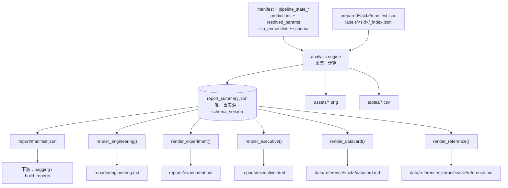
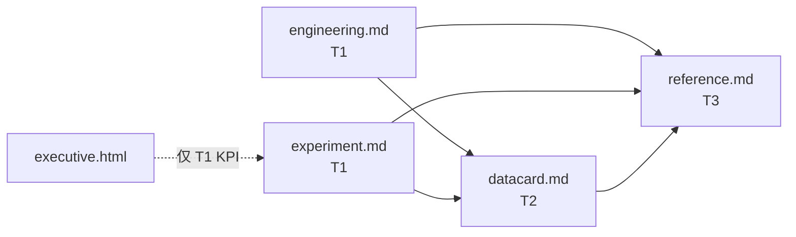

# v1.1.1 报告层重构设计（实施规范）

> 版本: v1.1.1 目标设计
> 日期: 2026-11-19
> 适用仓库: `ashare_signal_pipeline`（本仓库即内核模板，无需回灌）
> 读者: 工程实施 agent / 复核人
> 权威约束: `AGENTS.md`、`docs/01_pipeline_contract.md`
> 上游基线: tag `v1.1.0`（`fe9a3d6`）。本设计**不修改** step1–step6 任何语义。
> 配套计划: [implementation_plan.md](./implementation_plan.md)（文件级顺序与验收命令）
> 配套执行边界: [code_agent_prompt.md](./code_agent_prompt.md)
> 回归锚点: [baseline_v1.1.0.json](./baseline_v1.1.0.json)
> 设计依据与被否决方案: [design_memory.md](./design_memory.md)（**实施时不需要读**）

---

## 阅读方式（先看这一节）

**不要通读全文。** 本文是参考手册，按里程碑查阅。

| 里程碑 | 只读这些章节 | 实际行数（约） |
| :---: | :--- | ---: |
| M0 | §1.2 · §1.4 · §3（全部） · §8.1 · §8.2 | ~180 |
| M1 | §2.2 · §2.3 · §4.2 · §8.1 · §8.2 | ~170 |
| M2 | §2.4 · §3.2 · §4.5 · §4.6 · §4.7 | ~160 |
| M3 | §4.1 · §6（§6.1–6.6） · §4.8 | ~150 |
| M4 | §4.2 · §4.8 · §6（全部） | ~200 |
| M5 | §4.3 · §2.4 · §5（全部） | ~160 |
| M6 | §7 M6 · §10 · §9 | ~60 |

跨章节约束只有两条，任何时候都适用：

- **§2.3 不变量** —— 违反即视为 bug，不论在哪个里程碑
- **§8.2 断言清单** —— 每条都对应 `tools/verify_reports.py` 的一个 item

---

## 0. 目标与范围

### 0.1 一句话目标

在**不改动任何计算逻辑**的前提下，把"一份大杂烩 Markdown + 一份混装 HTML"拆分为**三份受众明确的报告**，并把报告生成从"文件名即契约"改为"事实表 + 产物清单契约"。

### 0.2 现状问题

| 编号 | 问题 | 证据 |
| :--- | :--- | :--- |
| P1 | 单份 Markdown 8 章混装工程与实验内容 | `analyze_experiment_results.py::render_markdown_report()` 共 436 行；§2.1「不同 step 的性能与瓶颈」属工程，§4–§7 属实验 |
| P2 | 领导版含工程细节 | `render_leadership_html()` 215 行，含「3. 不同 Step 的性能」「4. 结果图总览」 |
| P3 | 缺少 v1.1 新增信息 | 全文 `input_mode`/`coupling_mode`/`samples_id`/`label_name`/`buffer_*`/`dropped_no_target` 出现次数均为 **0** |
| P4 | 只呈现单一 run_mode | 同目录 `pipeline_state_*_smoke.json` 被完全忽略 |
| P5 | 文件名即契约 | `pipeline/ensemble/bagging.py` 硬编码 4 处报告文件名（1290/1292/2689/2699） |
| P6 | 无机器可读报告清单 | 下游只能猜文件名 |
| P7 | 步骤1 描述硬编码错误 | `analyze_experiment_results.py:1796` 对 samples 路径仍写「把原始持仓与行情数据清洗成可建模样本」 |

### 0.3 本次范围

| 编号 | 交付 | 说明 |
| :--- | :--- | :--- |
| S1 | 事实表补字段 | `report_summary.json` 增 `schema_version` + §3.2 字段；**不改任何计算口径** |
| S2 | 三份报告渲染器 | `engineering.md` / `experiment.md` / `executive.html` |
| S3 | 报告清单契约 | `analysis/reports/manifest.json` |
| S4 | 模块化拆分 | `report/` 包；`analyze_experiment_results.py` 只保留采集与计算 |
| S5 | 消费方接线 | `pipeline/ensemble/bagging.py` 改读清单（带旧名回退） |
| S6 | 可读性规范 | §6 全部条目落地为 `report/common.py` 公共函数 |
| S7 | T2/T3 载体 | 数据卡（每 `samples_id`）+ 参考页（每内核版本） |
| S8 | 独立对比工具 | `tools/compare_runs.py`（运行间对比不进报告） |
| S9 | 文档与演示 | `docs/10_architecture.md` 更新；双路径 demo 各出三份 |

> S8 说明：`md_report_to_html.py` 的图片内嵌缺陷已由 `60ce3b9` 修复，本迭代只做回归（A-3/A-23），不重复修改。

### 0.4 不覆盖

| 项 | 归属 |
| :--- | :--- |
| 任何指标口径、模型参数、切分规则变更 | 不在本迭代 |
| `holding_clean.parquet` 被 step2 原地覆盖的**语义修复** | `docs/16_potential_risks.md` PR-001，v1.2 |
| 报告 Web UI / 交互式看板 | 不覆盖 |
| 运行间对比内联进报告 | 明确禁止（A-22） |

---

## 1. 事实基准

### 1.1 数据源（只读）

| 数据 | 路径 | 用途 |
| :--- | :--- | :--- |
| 实验 manifest | `outputs/<ev>/metadata/experiment_manifest.json` | 定位产物、`latest_run_mode`、配置来源 |
| 管道状态 | `outputs/<ev>/metadata/pipeline_state_*.json` | 每步耗时、`details`、`checks`、`output_files` |
| 预测结果 | `outputs/<ev>/{train,val}_predictions.csv`、`predictions.csv` | 指标与分组分析 |
| 配置快照 | `outputs/<ev>/metadata/resolved_params.yaml`、`source_config.yaml` | 参数表 |
| 缩尾分位 | `data/features/<ev>/clip_percentiles.json` | 标签处理说明 |
| 特征 schema | `outputs/<ev>/metadata/model_feature_schema.json` | 特征数与对齐校验 |
| 模型 / 特征表 | `models/<ev>/lgb_model*.txt`、`data/features/<ev>/selected_features*.txt` | 特征重要性 |
| 样本集 manifest | `data/prepared/<samples_id>/manifest.json` | 采样方法、参数、股票数、按年分布 |
| 标签索引 | `data/labels/<samples_id>/_index.json` | 全部标签与覆盖率 |
| git 提交号 | `git rev-parse --short HEAD` | E0 运行标识（失败时写 `""`，不抛异常） |
| 解释器与依赖版本 | `sys.version_info` + `importlib.metadata.version()` | E0 运行标识；写入事实表 `run_env` |

### 1.2 现有 `report_summary.json` 结构

顶层键（重构前）：`experiment_version`、`generated_at`、`input_artifacts`、`analysis_scope`、`pipeline_steps`、`resolved_params`、`model_feature_schema`、`cleaning`、`split_overview`、`overall_test`、`test_quintile`、`test_median_split`、`test_threshold_filters`、`monotonic`、`artifacts_generated`、`feature_importance_top20`、`feature_alignment`

**结论：三份报告需要的数值已全部现成。本迭代只补元数据、换表现层。**

### 1.3 现状覆盖缺口（v1.1 内容 → 当前报告）

字段计数证据（`analyze_experiment_results.py` 全文）：`input_mode: 0`、`coupling_mode: 0`、`samples_id: 0`、`label_name: 0`、`buffer_: 0`、`dropped_no_target: 0`、`zero_variance: 0`、`raw_extracted: 0`。

| 重构内容 | 事实来源 | 当前报告 | 判定 |
| :--- | :--- | :--- | :---: |
| 输入模式 / 耦合模式 | `step1.details.input_mode/coupling_mode` | 未提及 | ❌ |
| 样本集标识 / 标签名 / 覆盖率 | `step1.details.{samples_id,label_name,label_hash,label_non_null_ratio}` | 未提及 | ❌ |
| 无标签丢弃量 | `step1.details.dropped_no_target` | 未提及 | ❌ |
| 样本集指纹 | `samples_set_hash`、`datebar_fingerprint` | 未提及 | ❌ |
| 采样方法/参数/股票池/按年分布 | `data/prepared/<sid>/manifest.json` | 未提及 | ❌ |
| 标签定义与可选标签清单 | `data/labels/<sid>/_index.json` | 未提及 | ❌ |
| buffer 实测天数 | `step5.buffer_train_val_days=73`、`buffer_val_test_days=63` | 只列配置边界 | ⚠ |
| 特征漏斗 | `step4.{raw_extracted_feature_columns,zero_variance_dropped,selected_features}` | 只写「53 列、入选 50」 | ⚠ |
| 各集合 target 分布 | 逐 split `target_raw` | 只给均值 | ⚠ |
| 步骤1 描述 | — | **硬编码「把原始持仓与行情数据清洗成可建模样本」，对 samples 路径是错误描述** | ❌ 错误 |

### 1.4 数值锚点

全部锚点在 [baseline_v1.1.0.json](./baseline_v1.1.0.json)，本文件不重复数字。要点：

| 锚点类别 | 位置 |
| :--- | :--- |
| step1–step6 关键数值（两路径） | `experiments.demo_old` / `experiments.demo_new` |
| 报告必须呈现的分组/单调性/稳健性数值 | `report_anchors.demo_new` |
| 契约常量（schema 版本、路径、必填键） | `report_contracts` |
| 各里程碑断言条数期望 | `expected_item_counts` |

任何一项不相等 → 视为重构引入计算副作用，**立即停止**。

### 1.5 信息价值评估（哪些该报、哪些不该报）

判据：**一个数字如果不会改变任何决策，就不该占用读者注意力。**

| 信息 | 决策价值 | 唯一性 | 变化频率 | 判定 | 落点 |
| :--- | :---: | :---: | :--- | :--- | :--- |
| `input_mode` / `coupling_mode` | 高 | 高 | 每实验 | **必报** | 报告头 + X0 |
| `samples_id` | 高 | 高 | 每样本集 | **必报** | 报告头 |
| `label_name` | 高 | 高 | 每实验 | **必报** | 报告头 + X1.3 |
| `dropped_no_target` / `label_coverage` | 高 | 高 | 每实验 | **必报** | X1.1 |
| 标签公式 | 高 | 中 | 每内核版本 | 必报但**引用不展开** | X1.3 一行 + 数据卡/参考页 |
| 可选标签清单及 coverage | 中 | 高 | 每样本集 | 报一次 | 数据卡 D4 |
| buffer 实测 73/63 | 中 | 高 | 每实验 | 报（1 行） | X2 |
| 特征漏斗 324→20→100→50 | 中高 | 高 | 每实验 | 报（小表），**唯一归属 X4** | X4 |
| 各集合 target **五数 + IQR + 胜率** | **高** | 中 | 每实验 | **必报** | X2 |
| 漂移"提示" | 中 | 低 | 每实验 | **必报，但标注阈值是经验约定** | X2 |
| 耗时 / 吞吐 / 产物大小 | 高 | 高 | 每运行 | 报 | engineering |
| smoke vs full 对照 | 中高 | 高 | 每版本 | 报 | engineering |
| 每步 `checks` 全量 | 中 | 高 | 每运行 | 报（折叠） | engineering |
| 四类指纹 | 低 | 高 | 每运行 | 附表 + 报告头短哈希 | engineering 附表 |
| `feature_schema` 全量列名 | 低 | 中 | 每实验 | 不报（已在 `tables/`） | — |

**三条结论**

1. 约 1/4 候选信息不值得进正文（指纹细节、全量列名）。
2. **极值与尾部风险必报**：`target` 的 min/max 决定最坏情况损失与策略容量；五数概括必须与 IQR 同表出现，避免读者只被极值带偏。
3. 漂移"提示"要报，但**不得写成"判定"**：1pp / 5pp 是经验约定，无 p 值、非自适应。

### 1.6 信息三层寿命模型

| 层 | 变化频率 | 例子 | 正确载体 |
| :--- | :--- | :--- | :--- |
| **T1 运行级** | 每次跑 | 耗时、行数、MAE/Spearman、checks、产物大小 | 三份报告 |
| **T2 数据级** | 换样本集/标签 | 采样方法、`ma_period`、股票池、标签公式、coverage、按年分布、可选标签清单 | 数据卡（每 `samples_id`） |
| **T3 内核级** | 改内核 | step1–6 语义、指标定义、切分规则、buffer 规则 | 参考页（每内核版本） |

若把 T2/T3 复制进每次实验报告，会有三个后果：体量膨胀、**定义过期且无从察觉**、交叉核对成本上升。因此分级引用，引用格式固定：

```markdown
> 定义见「参考页 §R4 切分规则」或「数据卡 <samples_id> §D4 标签清单」
```

### 1.7 表达能力边界

| 问题 | 回答 |
| :--- | :--- |
| 三份报告能否承载全部 T1？ | **能** |
| 能否承载 T2/T3？ | 能装，但**不该装**（§1.6） |
| 加数据卡与参考页后能否覆盖全部信息？ | **能**，且每类信息只出现一次 |
| 需要更多报告？ | **不需要** |

产物总数：**3 报告 + 1 数据卡 + 1 参考页**。

---

## 2. 架构

### 2.1 数据流



### 2.2 模块布局与函数签名

新增 `report/` 包（仓库根，与 `pipeline/`、`tools/` 同级）：

| 文件 | 公开符号（签名固定） | 职责 | 行数预算 |
| :--- | :--- | :--- | ---: |
| `report/__init__.py` | `render_all(summary_path: Path, out_dir: Path, types: set[str], layout: str, spec_path: Path \| None = None) -> dict[str, Path]` | 编排入口 | ≤ 40 |
| `report/schema.py` | `SCHEMA_VERSION = "report-summary/1"`；`REQUIRED_KEYS: tuple[str, ...]`；`validate(summary: dict) -> None`（缺键抛 `SchemaError`）；`OPTIONAL_KEYS`；`DEGRADE_MATRIX: dict[str, str]` | 契约校验 | ≤ 150 |
| `report/load.py` | `load_summary(path: Path) -> dict`；`get(summary, dotted: str, default=None)`（点号路径取值）；`fmt_pct/fmt_num/fmt_int/fmt_hms/fmt_bytes` | 读取与取值 | ≤ 150 |
| `report/common.py` | `build_toc(sections) -> str`；`render_table(rows, cols, align, caption) -> str`；`details_block(title, body) -> str`；`figure(path, caption, read_hint) -> str`；`section(title, lead_sentence, body) -> str`；`explain_simple(text) -> str`（`> 简单说：`） | 可读性原语 | ≤ 320 |
| `report/datacard.py` | `render_datacard(summary: dict) -> str` | T2 数据卡 | ≤ 260 |
| `report/reference.py` | `render_reference(summary: dict) -> str` | T3 参考页 | ≤ 220 |
| `report/engineering.py` | `render_engineering(summary: dict) -> str` | E0–E11 | ≤ 420 |
| `report/experiment.py` | `render_experiment(summary: dict) -> str` | X0–X10 | ≤ 760 |
| `report/executive.py` | `render_executive(summary: dict, spec: dict) -> str` | K1–K6，自包含 HTML | ≤ 360 |
| `report/spec.py` | `load_spec(default_path: Path, override_path: Path \| None) -> dict`；`resolve_placeholders(spec, summary) -> dict`（未知占位符抛 `SpecError`） | 规格解析 | ≤ 220 |
| `report/build.py` | `write_all(outputs: dict[str, str], out_dir: Path, aliases: bool) -> dict[str, Path]`；`write_manifest(paths, summary_path, layout) -> Path` | 落盘与清单 | ≤ 240 |
| `report/_legacy.py` | `render_markdown_report(...)`（改造前实现的完整副本） | M1 的 golden 基线与回滚保障；M6 删除 | ≤ 460 |

新增 `tools/` 脚本：

| 文件 | CLI 契约 | 职责 |
| :--- | :--- | :--- |
| `tools/build_reports.py` | `--manifest PATH \| --experiment-version STR`（二选一必填）；`--types engineering,experiment,executive,datacard,reference`（默认前三）；`--layout {v1,v2}`（默认 `v1`，M5 起改默认 `v2`）；`--spec PATH`；`--dry-run` | 薄 CLI，调用 `report.render_all` |
| `tools/verify_reports.py` | `--analysis-dir PATH`（必填）；`--baseline PATH`（必填）；`--milestone M0..M6`（必填）；`--report PATH`（默认 `verify_report_reports.json`）；`--only A-1,A-3` | 断言引擎，输出 items + exit code |
| `tools/compare_runs.py` | `--left PATH`、`--right PATH`（必填）；`--output PATH`（默认 `outputs/_compare/<a>__vs__<b>.md`） | 运行间对比（不进报告），见 §11 |

#### 2.2.1 `--layout` 的确定语义

`--layout` **只控制两件事**，与 `reports/` 路径无关：

| 值 | `reports/` 目录 | `manifest.json` | 弃用 alias |
| :--- | :---: | :---: | :---: |
| `v1`（M0–M4 默认） | 照常写 | 不写 | 不写 |
| `v2`（M5 起默认） | 照常写 | 写 | 写 |

> 即：`reports/experiment.md` 从 M1 起始终存在；`--layout` 只决定"是否额外产出清单与旧名 alias"。这样 M1 的 golden 比对与 M5 的清单化互不干扰。

#### 2.2.2 `analyze_experiment_results.py` 的 CLI 增量

| 参数 | 语义 | 默认 |
| :--- | :--- | :--- |
| `--emit-summary-only` | 只写 `report_summary.json`，**不**渲染报告、**不**生成图/表 | 关闭（保持现状：采集 + 渲染） |
| `--layout {v1,v2}` | 透传给渲染层（语义同 §2.2.1） | `v1` |
| `--summary-schema {1}` | 事实表 schema 版本 | `1` |

`--emit-summary-only` 的退出码与全量一致：0 成功 / 1 采集失败 / 2 参数错误。该模式下**不得**触碰 `analysis/reports/`、`assets/`、`tables/`。

### 2.3 不变量（违反即 bug）

| # | 不变量 | 检查手段 |
| :---: | :--- | :--- |
| 1 | **单一事实源**：三份报告只允许读 `report_summary.json` 与 `reports/manifest.json`，禁止各自读 CSV/state | A-7（渲染函数入参只有 `summary`；code review + `rg` 扫描 `pd.read_csv`） |
| 2 | **零计算**：渲染器不做统计计算，只做格式化与派生（占比、Δ、排序取前 N） | A-7 |
| 3 | **幂等**：同一事实表重复渲染，除 `generated_at` 外内容逐字节一致 | A-6 |
| 4 | **可判定**：每个结论句后必须能在事实表找到对应字段；无来源数字不写 | A-20（占位符可解析） |
| 5 | **只读输入**：渲染阶段不写 `data/`、`models/`、`outputs/<ev>` 根目录 | code review（`write_all` 只写 `reports/`、`assets/`、`tables/`、`data/reference/`） |
| 6 | **不得内联运行对比** | A-22 |
| 7 | **step 语义零变更** | M0–M6 全程 `git diff` 不含 `pipeline/step*.py`、`data_prep/**` |

### 2.4 产物清单契约

`analysis/reports/manifest.json`：

```json
{
  "schema_version": "report-summary/1",
  "experiment_version": "kernel_v11/check/...",
  "generated_at": "2026-11-19T10:00:00+08:00",
  "source_summary_sha256": "ab12cd34",
  "layout": "v2",
  "reports": [
    {"type": "engineering", "audience": "engineer", "format": "md", "path": "reports/engineering.md", "title": "工程详细报告", "deprecated": false},
    {"type": "experiment", "audience": "researcher", "format": "md", "path": "reports/experiment.md", "title": "实验详细报告", "deprecated": false},
    {"type": "executive", "audience": "executive", "format": "html", "path": "reports/executive.html", "title": "管理层汇报", "deprecated": false},
    {"type": "experiment", "audience": "legacy", "format": "md", "path": "experiment_analysis_report.md", "deprecated": true, "alias_of": "reports/experiment.md", "removal_version": "v1.2"},
    {"type": "executive", "audience": "legacy", "format": "html", "path": "experiment_summary_for_leadership.html", "deprecated": true, "alias_of": "reports/executive.html", "removal_version": "v1.2"}
  ],
  "external": [
    {"type": "datacard", "path": "../../../../data/reference/<sid>/datacard.md"},
    {"type": "reference", "path": "../../../../data/reference/_kernel/v1.1.0/reference.md"}
  ]
}
```

- `path` 相对 `analysis/`；`external.path` 相对 `analysis/reports/`（允许跳出 outputs）。
- 消费方按 `audience` 选取；`deprecated: true` 的条目仅为兼容，v1.2 删除。

---

## 3. 数据契约

### 3.1 顶层必填键

见 [baseline_v1.1.0.json](./baseline_v1.1.0.json) 的 `report_contracts.required_summary_keys`（38 项）。

- 缺任一 → `report/schema.py::validate` 抛 `SchemaError`，`analyze_experiment_results.py` exit 1；
- 可选键缺失 → 按 §3.5 降级矩阵处理，并在报告末尾 `[WARN]` 声明。

### 3.2 新增字段（JSON 路径 + 口径）

| JSON 路径 | 类型 | 口径 / 来源 |
| :--- | :--- | :--- |
| `schema_version` | str | 常量 `report-summary/1` |
| `run_env` | dict | `{git_commit, python, pandas, numpy, scipy, lightgbm, tsfresh}`；取不到写 `null` |
| `run_modes` | list[str] | 扫描 `metadata/pipeline_state_*.json` 文件名后缀，去重排序 |
| `runs.{mode}.{step}.duration_seconds` | float | 该 mode 的 state 中 `steps.step_N.duration_seconds` |
| `runs.{mode}.updated_at` | str | state 的 `updated_at`；同 mode 多份取最新，并记 `rerun_count` |
| `input_identity.input_mode` | str | `step1.details.input_mode` |
| `input_identity.coupling_mode` | str | `step1.details.coupling_mode` |
| `input_identity.samples_id` | str | `step1.details.samples_id`（旧路径为 `""`） |
| `input_identity.label_name` | str | `step1.details.label_name`（旧路径为 `""`） |
| `input_identity.label_hash` | str | `step1.details.label_hash` |
| `input_identity.label_non_null_ratio` | float | `step1.details.label_non_null_ratio` |
| `input_identity.dropped_no_target` | int | `step1.details.dropped_no_target` |
| `input_identity.target_coverage` | float | `step1.details.target_coverage` |
| `fingerprints.datebar` | str | `step1.details.datebar_fingerprint` |
| `fingerprints.samples_set` | str | `step1.details.samples_set_hash` |
| `fingerprints.label_params` | str | `step1.details.label_hash` |
| `fingerprints.resolved_params` | str | `sha256(canonical_json(resolved_params))[:8]`（复用 `data_prep.ids.canonical_json`） |
| `buffer.required` | int | `step5.details.buffer_trading_days_required` |
| `buffer.train_val_days` | int\|null | `step5.details.buffer_train_val_days` |
| `buffer.val_test_days` | int\|null | `step5.details.buffer_val_test_days` |
| `buffer.status` | str | `step5.details.buffer_check_status`（`enforced` / `smoke_not_applicable`） |
| `feature_funnel.raw_extracted` | int | `step4.details.raw_extracted_feature_columns` |
| `feature_funnel.zero_variance_dropped` | int | `step4.details.zero_variance_dropped` |
| `feature_funnel.candidates` | int | `raw_extracted - zero_variance_dropped` |
| `feature_funnel.top_candidates` | int\|null | `resolved_params.feature_selection.top_candidates` |
| `feature_funnel.selected` | int | `step4.details.selected_features` |
| `feature_funnel.manual_added` | int | `len(step5.details.manual_features)` |
| `feature_funnel.model_input` | int | `model_feature_schema.feature_count` |
| `feature_funnel.consistency_ok` | bool | `selected + manual_added == model_input`（不等则 false，报告标 `[WARN]`） |
| `clip_percentiles.p1` / `.p99` | float | `clip_percentiles.json` 的 `p1` / `p99` |
| `clip_percentiles.by_split.{split}.clipped_count` | int | `(target - target_raw).abs() > 1e-12` 的行数 |
| `clip_percentiles.by_split.{split}.max_abs_delta` | float | 同上取 `abs` 最大值 |
| `target_stats_by_split.{split}.{min,p25,p50,p75,max}` | float | 该 split `target_raw` 的分位（`pandas.quantile`，线性插值） |
| `target_stats_by_split.{split}.iqr` | float | `p75 - p25` |
| `target_stats_by_split.{split}.win_rate` | float | `mean(target_raw > 0)` |
| `target_stats_by_split.{split}.mean` / `.std` | float | `target_raw` 的均值 / 样本标准差 |
| `drift_hint.{split}.median_delta_pp` | float | `(p50_split - p50_train) * 100` |
| `drift_hint.{split}.win_rate_delta_pp` | float | `(win_rate_split - win_rate_train) * 100` |
| `drift_hint.thresholds` | dict | `{"median_pp": 1.0, "win_rate_pp": 5.0}`（**常量，不随数据变**） |
| `label_span_stats`（**可选键**） | dict | 标签「有效持有期」口径，见 §3.2.1 |
| `drift_hint.{split}.exceeded` | list[str] | 超阈的指标名，如 `["median","win_rate"]` |
| `artifact_sizes[]` | list | `{path, bytes, mtime, group}`；`group ∈ {processed,slices,ts_features,features,splits,models,outputs}` |
| `smoke_vs_full.{metric}` | dict | `{smoke, full, delta}`；metric 至少含 `valid_samples`、`selected_features`、`best_iteration`、`mae`、`spearman`、`total_seconds` |
| `workload.{step}` | dict | `{input_units, units_kind, ops_per_unit, total_ops, parallelism, throughput_per_sec, attribution}` |
| `param_effective[]` | list | `{key, configured, effective(bool), reason}`；至少覆盖 §4.1 E10 表中 10 项 |
| `determinism` | dict | `{executed: bool, same_seed_rerun: bool\|null, sources_fixed: list[str]}` |
| `feature_drift.top10[]` | list | `{feature, ks}` 按 ks 降序 |
| `feature_drift.count_over_0_1` / `.median_ks` | int / float | 对全部模型特征计算 |
| `label_overlap.{horizon_days,share_gap_le_horizon,gap_p25,gap_p50,gap_p75,n_with_prev}` | — | 见 §3.4 |
| `group_time_concentration.by_group[]` | list | `{group, year, share}`（按 `normalize="index"`） |
| `group_time_concentration.max_share` / `.group_of_max` | float / int | — |
| `monthly_returns[]` | list | `{ym, mean, count, win_rate}` |
| `datacard_path` / `reference_path` | str | 相对 `analysis/` 的路径 |

### 3.3 run_mode 聚合规则

1. 枚举 `metadata/pipeline_state_*.json`，从文件名解析 `smoke` / `full`（匹配 `_(smoke|full)\.json$`）。
2. `pipeline_steps` 保留 manifest 的 `latest_run_mode` 作为**主视图**。
3. `runs` 保存每个 mode 的步骤耗时、关键行数与 `updated_at`。
4. 同 mode 多份 state → 取 `updated_at` 最新，另记 `rerun_count`，报告注明「重跑 N 次」。
5. 若某 mode 缺失 → `runs` 不含该键，`smoke_vs_full` 只含单边值且 `delta: null`，报告写「未执行」。

### 3.2.1 `label_span_stats`（可选键）

阈值 `span_warn_days` 取自 `baseline.report_contracts.constants.label_span_warn_days`（当前 60）；报告中出现的该数字必须由此常量替换，不得写死。

| 字段 | 口径 |
| :--- | :--- |
| `horizon_days` | `target.horizon_days`（旧路径为 `0`，此时整块写 `null`） |
| `n_valid` | `entry_idxd > 0 且 exit_idxd > 0` 的标签行数 |
| `median_days` | `entry_idxd → exit_idxd` 的日历天数中位数 |
| `p99_days` | 同上 P99 |
| `max_days` | 同上最大值 |
| `share_gt_60d` | 跨度 > 60 天的占比 |
| `n_gt_60d` | 跨度 > 60 天的条数 |
| `by_split.{split}.n_gt_60d` | 各 split 的条数（可选子键） |
| `longest_pause_rows` | 样本窗口内最长连续 `paused=1` 行数（可选子键） |
| `policy` | `"uncapped"`（当前） / `"capped:<days>"`（PR-007 修复后） |

> 为何是可选键、修复后是否仍保留：见 `design_memory.md` §4.9。

### 3.4 稳健性四项的计算定义（X9）

| 项 | 定义 | 实现要点 |
| :--- | :--- | :--- |
| 特征漂移 KS | 对每个模型特征，`scipy.stats.ks_2samp(train[c].dropna(), test[c].dropna()).statistic` | 只对 `model_feature_schema.feature_columns` 计算；样本量差异不影响 KS 统计量本身 |
| 标签重叠 | 每个 symbol 的非停牌交易日序列按 `cumcount` 编号为 `t`；同一 symbol 相邻样本的 `gap = t_i - t_{i-1}`；`share_gap_le_horizon = P(gap ≤ horizon_days)` | `idxs` 由 `sample_id` 解码（`market*1e14 + code6*1e8 + idxd`）；只用 `predictions.csv` 的 test split |
| 分组时间集中度 | `pd.crosstab(group, year, normalize="index")`，`year = signal_date // 10000`；`max_share` 取全表最大 | group 用五分组（`pred_group`） |
| 月度收益 | `ym = signal_date // 100`；按月聚合 `target_raw` 的 `mean`、`count`、胜率 | 月数 = 去重后的 `ym` 个数 |

> 四项都必须写入事实表**数字**；未计算时写 `null` 并在报告写「未计算 + 原因」（A-27）。

#### 3.4.1 稳健性计算允许读取的文件

采集阶段（`analyze_experiment_results.py`）允许读取，且**仅**允许：

| 文件 | 用途 |
| :--- | :--- |
| `outputs/<ev>/{train,val}_predictions.csv`、`predictions.csv` | 特征列、`target`/`target_raw`/`y_pred`/`sample_id`/`signal_date` |
| `data/processed/<ev>/datebar.parquet` | 标签重叠所需的"每 symbol 非停牌交易日序号" |
| `outputs/<ev>/metadata/model_feature_schema.json` | 确定"模型特征"集合（KS 只对这些列算） |
| `data/features/<ev>/clip_percentiles.json` | 缩尾分位 |
| `data/prepared/<samples_id>/samples.parquet` | 按年分布（仅当 prepared manifest 无该字段时；只读 `idxs`/`idxd` 两列） |

任一文件缺失 → 对应字段写 `null` + `reason`，不抛异常（A-27 允许"未计算 + 原因"）。

### 3.5 降级矩阵（可选键缺失时）

| 缺失项 | 报告行为 | 断言 |
| :--- | :--- | :--- |
| `smoke_vs_full` | E7 只显示 full 列，备注「smoke 未执行」 | 不 fail |
| `feature_drift` / `label_overlap` | X9 对应小节写「未计算：<原因>」 | A-27 检查"数字或原因"二者其一 |
| `clip_percentiles` | X5 不显示 P1/P99，标 `[WARN]` | 不 fail |
| `artifact_sizes` | E6 只给目录级汇总 | 不 fail |
| `workload` | E8 退化为「耗时 + 规模」，不给归因列 | 不 fail |
| `param_effective` | E10 整节省略并标 `[WARN]` | A-28 只在该键存在时检查 |
| `label_span_stats` | X1.3 不显示「有效持有期」行，标 `[WARN]` | A-29 只在该键存在时检查 |

### 3.6 `workload` 的派生规则（E8 唯一来源）

每步一条记录，字段与推导方式固定：

| 字段 | 推导 |
| :--- | :--- |
| `input_units` | 该步处理的基本单位数（见下表"单位"列） |
| `units_kind` | `samples` / `rows` / `trees` |
| `ops_per_unit` | 每单位计算量（见下表"每单位"列） |
| `total_ops` | `input_units × ops_per_unit` |
| `parallelism` | 该步实际并行度（`1` 或 `tsfresh.tsfresh_n_jobs` 解析值；`0` 视为 `os.cpu_count()`） |
| `throughput_per_sec` | `input_units / duration_seconds` |
| `attribution` | `io` / `cpu` / `mixed`（按下表固定判定，不由 agent 自由发挥） |

| 步骤 | 单位 | `ops_per_unit` 推导 | `attribution` |
| :--- | :--- | :--- | :--- |
| step1 | samples | `1` | `io` |
| step2 | rows | `1` | `io` |
| step3 | rows | `len(indicators_profile_columns)`（由 `indicators.profile` 查表：`base=12`、`v3_enriched=16`） | `cpu` |
| step4 | samples | `step4.details.raw_extracted_feature_columns`（即实际计算的 tsfresh 特征数） | `cpu` |
| step5 | rows | `1` | `io` |
| step6 | trees | `1` | `cpu` |

`input_units` 取值：step1 = `step1.details.sample_count`；step2/step3 = `step3.details.rows`；step4 = `step4.details.samples`；step5 = `step5.details.train_rows + val_rows + test_rows`；step6 = `step6.details.best_iteration`。

> E8 的正文必须显式写：「step4 计算的是 <raw_extracted> 个特征，不是入选的 <selected> 个」；两个数字都取自 `feature_funnel`。

### 3.7 `param_effective` 的最小清单（A-28）

必须覆盖以下 10 项，`effective` 的判定规则固定：

| # | key | 判定规则 |
| :---: | :--- | :--- |
| 1 | `input.mode` | 恒 `true`（决定分支） |
| 2 | `target.source` | 恒 `true` |
| 3 | `target.label` | `input.mode == "samples"` 时 `true`；否则 `false`（旧路径不用标签文件） |
| 4 | `data_prep.samples.*` | 仅当本次重建样本集时 `true`；复用既有产物时 `false`，`reason="复用已有 samples_id，仅参与 id 推导"` |
| 5 | `data_prep.labels.*` | 同上 |
| 6 | `manual_features.include_signal_date_selection_score` | `input.mode == "samples"` 时 `false`，`reason="samples 模式无该列"`；否则 `true` |
| 7 | `manual_features.include_non_trading_ratio` | `true` |
| 8 | `indicators.profile` | `true` |
| 9 | `tsfresh.fc_profile` | `true` |
| 10 | `lgb.num_threads` | `true` |

可选补充（有则加，无则不加）：`sample_filter.max_holding_days`、`time_split.enforce_buffer`、`feature_selection.selection_mode`。

### 3.8 `determinism` 的填写规则（E10）

| 字段 | 规则 |
| :--- | :--- |
| `executed` | **仅当**同一 `experiment_version` 下存在两份以上**同 mode** 的 state 且其 step6 `best_iteration`/`mae` 可比较时为 `true`；否则 `false` |
| `same_seed_rerun` | `executed == true` 时填比较结果（三指标全等 → `true`）；`executed == false` 时填 `null` |
| `sources_fixed` | 固定输出三条：`["seed=<value>", "num_threads=<value>", "tsfresh 结果按 sample_id 对齐（并行仅改变计算顺序）"]` |

> `executed == false` 时报告必须显示「未执行」，**不得**显示「已通过」。

### 3.9 `artifact_sizes` 的扫描规则（E6）

`<ev>` 即 `experiment_version` 字面值（如 `kernel_v11/check/kernel_v11_20261102_demo_new_6e499192`），扫描以下 7 个根：

```
data/processed/<ev>
data/slices/<ev>
data/ts_features/<ev>
data/features/<ev>
data/splits/<ev>
models/<ev>
outputs/<ev>
```

每文件一条：`{path（仓库相对，正斜杠）, bytes, mtime（ISO8601）, group}`；`group` 取上表后缀名（`processed`…`outputs`）。
目录不存在 → 跳过且记入 `missing_groups`；不抛异常。E6 的"合计"必须排除 `missing_groups`。

---

## 4. 报告规范

### 4.1 `engineering.md`（工程详细）

| 章节 | 内容 | 数据来源 | 行数预算 |
| :--- | :--- | :--- | ---: |
| 头部 | 5 行元数据（版本 / run_mode / 生成时间 / 事实源 sha256 前 8 / schema） | — | ≤ 6 |
| 三行摘要 | 做了什么 / 结果如何 / 要注意什么 | 派生 | ≤ 5 |
| 目录 | 自动生成 | `build_toc` | ≤ 12 |
| E0 运行标识 | 版本、run_mode、git commit、内核基线、输入模式、seed、`num_threads`、解释器与关键依赖版本 | manifest + resolved_params | ≤ 25 |
| E1 输入溯源 | 3 个输入路径 + 指纹校验结论 + **"若怀疑结果不一致先比这三个指纹"用法说明**；完整指纹指向附表 | `input_identity`、`fingerprints` | ≤ 30 |
| E2 步骤执行 | 状态 / 耗时 / 占比 / **吞吐（含规模）**；一句"耗时是墙钟时间"的口径说明 | `pipeline_steps` | ≤ 22 |
| E3 瓶颈 | 最慢 3 步 + 优化顺序结论 | 派生 | ≤ 18 |
| E4 校验明细 | 每步 `checks` 全量，分 3 个 `<details>` 折叠（step1+2 / step3–6） | `pipeline_steps[].checks` | ≤ 60 |
| E6 产物清单 | 7 类目录：文件数 / 体积 / **产出步骤** / 里面是什么·目的 / 谁会用 / 多大算正常 + 逐文件折叠；**必须含 `data/processed` 专节（见下）** | `artifact_sizes` | ≤ 90 |
| E7 数据质量与 smoke 对照 | `nan_filled` / `inf_replaced` / `insufficient_history` 分解（**唯一归属**）+ smoke vs full 对照表（含 Δ） | `smoke_vs_full` | ≤ 40 |
| E8 性能与工作量归因 | 每步：工作量（单位数 × 每单位计算量）× 并行参数 → 吞吐 → 归因（I/O 或 CPU）；**必须写明"实际计算特征数 ≠ 入选特征数"** | `workload` | ≤ 35 |
| E9 参数生效清单 | ≥10 个配置项 → 生效状态 → 未生效原因 | `param_effective` | ≤ 30 |
| E10 确定性校验 | 同 seed 重跑一致性、随机源固定项；**未执行必须标"未执行"** | `determinism` | ≤ 15 |
| E11 复现命令 | 实际命令行 | manifest | ≤ 15 |
| 附表 A | 四类指纹全值 | `fingerprints` | ≤ 12 |

**E6 的 `data/processed` 专节（强制）**
必须包含：

| 文件 | 由谁读 | 里面是什么 | 怎么来的 |
| :--- | :--- | :--- | :--- |
| `holding_clean.parquet` | step2 | 建模样本表 | 按 `input_mode` 分支描述；**必须写"会被 step2 覆盖"并给出两次行数** |
| `datebar.parquet` | step2 | 行情底表 | 从 `dateBar.pkl` 解包 + 排序 |

并附一行警告：

```markdown
> ⚠️ `holding_clean.parquet` 会被 step2 覆盖：step1 写出 <step1_sample_count> 行（全部有标签样本），
> step2 校验 60 日历史后重写为 <step2_valid_samples> 行。看行数时请确认读的是哪一步之后的状态。
> 该覆盖属已知反模式，详见 docs/16_potential_risks.md PR-001。
```

**E6 的 7 类目录语义（固定文案，逐行使用；数字与体积由事实表填充）**

| 目录 | 产出步骤 | 里面是什么 / 目的 | 谁会用 | 多大算正常 |
| :--- | :--- | :--- | :--- | :--- |
| `data/processed` | step1（+step2 覆盖 `holding_clean`） | 清洗后的样本表 + 行情日历；后续所有步骤的输入底座 | 排障、复算样本量 | 体积由行情表决定，约数百 MB |
| `data/slices` | step2 | 每条信号的定长窗口（N 行/样本）；把时间序列变成定长张量 | step3 输入 | 行数 = 有效样本 × `lookback_days` |
| `data/ts_features` | step3+step4 | tsfresh 全量特征；供 step4 筛选 | step4 输入 | 最大产物，约为 slices 的数倍 |
| `data/features` | step4 | 筛选后的建模特征 + 入选清单 + 缩尾分位 | step5 输入、复现筛选 | ≈ 样本数 × 模型特征数 × 8 字节 |
| `data/splits` | step5 | 按时间切好的 train/val/test；保证测试集是"未来" | step6 输入、报告统计 | 三者之和 = 建模样本数 |
| `models` | step6 | LightGBM 文本模型（可读） | 推理、特征重要性 | 与树数量成正比 |
| `outputs` | step6 + 分析 | 三集合预测 + 报告 + 元数据 | 报告、下游分析 | 预测 CSV 含全部特征列，故偏大 |

> 表下固定一句用法说明：**"先看产出步骤判断能否跳过（如只改模型参数，step1–4 产物可复用）；再看多大算正常判断体积是否异常。"**

### 4.2 `experiment.md`（实验详细）

| 章节 | 内容 | 数据来源 | 行数预算 |
| :--- | :--- | :--- | ---: |
| 头部 + 三行摘要 + 目录 | 同 4.1 | — | ≤ 25 |
| X0 实验卡片 | 一句话结论；输入模式 / 耦合模式；样本集、标签、建模样本、模型 5 行表；1 条数据卡引用 | `input_identity` | ≤ 28 |
| **X1 数据构建** | 三小节，见 §4.2.1 | `input_identity`、`pipeline_steps`、prepared manifest | ≤ 120 |
| **X2 数据切分** | 逻辑 / 边界 / buffer 实测 / 切分统计 / 五数+IQR / 分布图 ×2 / 漂移提示 / 泄漏检查，见 §4.2.2 | `split_overview`、`buffer`、`target_stats_by_split`、`drift_hint` | ≤ 80 |
| X3 步骤 1–6 参数与统计 | 6 小节，每节「消费配置表 + 产出统计」；**不复述** nan/inf（归 E7） | `resolved_params` + `pipeline_steps` | ≤ 150 |
| X4 特征工程 | 12 指标、tsfresh profile、**特征漏斗（唯一归属）**、来源/类型分布、一致性检查 | `feature_funnel` + schema | ≤ 70 |
| X5 模型与标签处理 | 开头 3 行"为什么用 LightGBM"；lgb 全参数；缩尾 P1/P99 + 被缩尾条数 | `resolved_params` + `clip_percentiles` | ≤ 55 |
| X6 模型表现 | 三集合 MAE/Spearman/Pearson + 行数 + train→test 衰减 | 现有 `_build_split_model_performance_table` | ≤ 30 |
| X7 分组与单调性 | 抗噪汇总表 + **5 张图**（train/val/test/合并/预测柱状）+ 五分组表 + 中位数二分表 + 阈值表 + 结论 | 现有四块 | ≤ 130 |
| X8 特征重要性 | Top20（gain/gain_share/来源）+ 对齐校验 | 现有 | ≤ 30 |
| **X9 稳健性与漂移** | 特征漂移 / 标签重叠 / 分组时间集中度 / 月度收益，见 §4.2.3 | `feature_drift`、`label_overlap`、`group_time_concentration`、`monthly_returns` | ≤ 80 |
| **X10 结论与局限** | 四小节：分视角结论 / 可探索方向 / 不宜做的事 / 已知局限，见 §4.2.4 | 派生 | ≤ 100 |

#### 4.2.1 X1 数据构建

**X1.1 数据处理与合并**

| 段落 | 必列内容 |
| :--- | :--- |
| 逻辑 | **按 `input_mode` 分支**：`holding_file` = 从持仓表按三条规则过滤；`samples` = 样本集与标签按 `sample_id` left join 后丢弃空标签 |
| 本次统计 | 样本集行数 → 有效行数 → 丢弃数 → 覆盖率；target 中位 / IQR / 胜率 |
| 可复现 | `samples_id`、`label_name`（各一行） |
| 引用 | `> 完整清洗规则见「参考页 §R1」` |

**X1.2 样本构建**

| 模式 | 报告写什么 |
| :--- | :--- |
| `samples` | ① **构造逻辑表（5 行）**：事件定义 / 上轨公式 / 前置条件 / 股票池 / 价格口径，每行附"为什么这样定" ② 样本规模表：行数、股票数（沪/深）、日期范围、停牌占比、是否抽样 ③ **按年分布表** ④ **样本数据处理表**：停牌、历史不足、缺失值、重复事件 ⑤ `> 参数与股票池细则见数据卡 §D1–D3` |
| `holding_file` | 一行「不适用：样本来自持仓表，见 X1.1」 |

**X1.2 构造逻辑表（`samples` 模式的固定 5 行，逐字使用）**

| 环节 | 规则 | 为什么这样定 |
| :--- | :--- | :--- |
| 事件定义 | `close[t] > upper[t]` 且 `close[t-1] ≤ upper[t-1]` | 只取"上穿"当天，避免突破后连续多日重复计数 |
| 上轨公式 | `upper = MA(close, 20) + 2 × STD(close, 20)`，STD 用样本标准差（`ddof=1`） | 20 日窗口 + 2 倍标准差是布林带常用参数，覆盖约 95% 正常波动 |
| 前置条件 | `upper[t-1]` 非空（至少 21 个交易日历史） | 没有前一日上轨就无法判断"上穿"，会误收第一天就突破的样本 |
| 股票池 | 排除 `sh000` / `sz399` / `sh950` 前缀；每个 symbol 非停牌天数 ≥ 60 | 排除指数与次新股，保证后续 60 日窗口可构造 |
| 价格口径 | 后复权价，不乘复权因子 `xs` | 保证跨除权的价格可比 |

> `ma_period` / `std_mult` 的实际值从 `resolved_params.data_prep.samples.params` 读取，**不得**在模板里写死 `20` / `2.0`（表中数字仅为可读性示例）。

**样本数据处理表（固定 4 行）**

| 处理 | 做法 | 影响 |
| :--- | :--- | :--- |
| 停牌 | 切片取信号日及之前最近 N 个**非停牌**交易日；停牌行不进入窗口 | 避免用停牌日价格计算指标 |
| 历史不足 | 非停牌历史 < `lookback_days` → step2 丢弃 | 次新股/复牌股被排除；数量取自 `dropped_samples` |
| 缺失值 | step3 对滚动窗口起点 NaN 记数并填充；inf 置 NaN 后填 0 | 数量取自 E7（本报告不复述） |
| 重复事件 | 同一股票同日只保留一条（事件定义本身保证） | — |

**X1.3 标签构建**

| 段落 | 必列内容 |
| :--- | :--- |
| 逻辑 | 一句话定义（入场 = 次一非停牌日开盘；持有 h 个非停牌日；`close/open − 1`）+ 涨停是否剔除 |
| 选择依据 | 一句话（与信号持有期匹配、避免与旧规则耦合） |
| 本次统计 | 覆盖率、非空行数、中位 / IQR、缩尾 P1/P99 |
| **有效持有期** | `entry→exit` 日历跨度：中位 / P99 / 最大；**跨度 > `<span_warn_days>` 天占比**（= 跨停牌样本比例） |
| 引用 | `> 全部可选标签及覆盖率见「数据卡 <sid> §D4」` |

**有效持有期行（`label_span_stats` 存在时必须输出，逐字使用）**

```markdown
| 有效持有期 | 中位 <median_days> 天 / P99 <p99_days> 天 / 最大 <max_days> 天；跨度 > <span_warn_days> 天占 <share_gt_60d>（<n_gt_60d> 条） |
```

当 `share_gt_60d > 0` 时，紧随其后必须输出成因说明（不得省略）：

```markdown
> ⚠️ **标签名义为「<horizon_days> 个交易日」，实为「<horizon_days> 个非停牌交易日」**：停牌会把实际跨度拉长至数十天到数年。
> 跨停牌的复牌首日通常无涨跌幅限制，价格前后不可比；这些样本的极值不代表可预测收益。
> 详见 `docs/16_potential_risks.md` PR-007 / PR-008。
```

`share_gt_60d == 0` 时，仍保留「有效持有期」行，但不输出警告块。

#### 4.2.2 X2 数据切分

| 段落 | 必列内容 |
| :--- | :--- |
| 切分逻辑 | 全量：按 `signal_date` 严格时间切；冒烟：随机 70/15/15（**必须标注「无时间隔离」**） |
| 策略边界 | `train_end` / `val_start` / `val_end` / `test_start` / `buffer_trading_days` / `enforce_buffer` |
| buffer 实测 | 要求 60，实测 73 / 63，状态 `enforced` |
| 切分后统计 | 每集合：行数、占比、日期范围 |
| **target 分布** | 每集合 **min / P25 / P50 / P75 / max / IQR / 胜率**（3 行 × 7 列） |
| **分布图 ×2** | `target_raw`（显示按 0.1%/99.9% 裁切，图注写明"统计量未裁"）+ `target`（缩尾后直绘，不裁切） |
| **漂移提示** | 中位差、胜率差 + 固定阈值说明（见下） |
| 泄漏检查 | buffer ≥ `lookback_days`；特征筛选与缩尾是否只在训练集内 |

**固定文案（漂移提示）**

```markdown
> 提示：<split> 中位数 <x>%，训练集 <y>%，相差 <d> 个百分点<，超过 1pp 经验阈值，建议关注分布差异|（未超阈）>。
> 阈值说明：1pp / 5pp 为本项目**经验约定，不是统计检验结果**（无 p 值、非自适应），
> 仅用于提醒读者核对，不构成"存在分布漂移"的结论。
```

**五数表的固定读法（图下/表下必附）**

```markdown
> 读法：P25–P75（IQR）反映主分布宽度；min/max 是尾部极值，代表最坏/最好情况，两者需一起看。
```

#### 4.2.3 X9 稳健性与漂移

| 小节 | 必列内容 | 判读口径 |
| :--- | :--- | :--- |
| X9.1 特征漂移 | Top10 KS（特征名 + KS 值）+ 汇总（超 0.1 个数、中位 KS） | KS > 0.1 视为明显差异；与 X6 衰减并列解读 |
| X9.2 标签重叠 | `share_gap_le_horizon`、gap 三分位、`n_with_prev` | 明确写「样本非独立、置信区间被高估，不得用样本数当独立样本数」 |
| X9.3 分组时间集中度 | 五分组 × 年份占比表 + `max_share` | `max_share > 0.70` 时提示"结论可能被单年行情放大" |
| X9.4 月度收益 | 月数、正收益月占比、最好/最差月、月度标准差 | 说明"均值由少数月份贡献" |

规则：

1. 四项都要**数字**；未计算写「未计算 + 原因」（A-27）。
2. 本节只提供证据，不下"稳健"结论。
3. **本迭代不配图**，在 X9 开头留一行：`> 图待补（v1.2）：特征漂移 Top10 条形图、月度收益柱状图`。
4. 四项末尾给一条 `> 简单说：` 提示（仅 1 条，放在 X9 整体末尾）。

#### 4.2.4 X10 结论与局限

| 小节 | 内容 | 约束 |
| :--- | :--- | :--- |
| X10.1 分视角结论 | **四组**：统计 / 交易 / 数据与标签 / 工程；每组 3–4 条，每条必须带数字 | 不得跨组重复同一条 |
| X10.2 可探索方向 | 表格：优先级（P0/P1/P2）、方向、预期产出、成本 | ≥ 8 行 |
| X10.3 不宜做的事 | 表格：反模式 + 为什么 | ≥ 3 行 |
| X10.4 已知局限 | 列表：能力缺失、未计成本、样本期、未校正项、外推边界 | ≥ 4 条 |

内容基线见 [baseline_v1.1.0.json](./baseline_v1.1.0.json) 的 `report_anchors` 与 `design_memory.md` §6。

### 4.3 `executive.html`（领导版，规格驱动）

#### 4.3.1 默认结构

| 区块 | 内容 | 约束 |
| :--- | :--- | :--- |
| K1 KPI 带 | 基线 4 个（`locked: true`）：测试集 Spearman、五分组头尾收益差、可用样本、模型特征数 | **必在**；可追加 |
| K2 结论 | 3 条，每条 ≤ 40 字，无术语 | 默认 3 条 |
| **K3 100 组完整视图** | 抗噪汇总表（秩相关 / 首10 / 末10 / 差值）+ **5 张图**，顺序固定：训练 → 验证 → 测试 → 三集合合并（折线）→ 各组预测值（柱状） | 5 图必须全；**不展示逐组明细** |
| **K4 分组与过滤效果** | 五分组表（5 行）+ 中位数二分表（低/高/提升）+ 阈值过滤表（5 档） | 三表齐全 |
| K5 风险提示 | 一句话，独立成行 | **必在**，置于行动项之前 |
| K6 行动项 | 2–3 条 | 无时间承诺 |

**K3 图注（固定四句）**

```markdown
① 横轴：把样本按模型预测分从低到高平均分成 100 组；纵轴：每组的真实收益均值。
② 曲线整体上行 = 排序有效；走平或抖动 = 该区间没有稳定信息。
③ 看的是"排序准不准"，不是"预测涨跌幅准不准"。
④ 首尾单组约 500 条，均值易被个别极端样本带动；趋势请看整体秩相关与首/末 10 组均值。
```

**阈值表的固定标签**：使用「保留前 50% / 40% / 30% / 20% / 10%」，不得写「剔除后 N%」（歧义）。并附强调：

```markdown
> 注意：阈值不是越激进越好。只留前 10% 时收益回落——说明最顶端预测并不可靠，不宜当"精选器"。
```

#### 4.3.2 规格文件

- 默认规格：`configs/report/executive_default.yaml`（入库）
- 覆盖规格：`configs/report/executive_override.yaml`（可选，入 `.gitignore`）

```yaml
schema: executive-report/1
title: 策略信号模型 · 实验汇报
subtitle: "版本 {kernel_version}｜全量样本 {sample_count_h}｜测试期 {test_start} ~ {test_end}"

kpi:
  - id: spearman
    label: 排序能力
    value: "{step6.spearman:+.3f}"
    note: "测试集 Spearman（0 为无排序力）"
    locked: true
  - id: head_tail
    label: 头尾收益差
    value: "{(test_quintile.4.target_raw_mean - test_quintile.0.target_raw_mean) * 100:+.2f}pp"
    note: "五分组最高 − 最低"
    locked: true
  - id: samples
    label: 可用样本
    value: "{sample_count_h}"
    note: "标签覆盖率 {label_coverage_pct}"
    locked: true
  - id: features
    label: 模型特征
    value: "{model_feature_schema.feature_count}"
    note: "从 {feature_funnel.raw_extracted} 个候选筛出"
    locked: true

sections:
  - type: conclusions
    items: ["…", "…", "…"]
  - type: monotonic_100
    order: [train, val, test, all, pred]
    summary_table: true
    detail_table: false
  - type: groups
    tables: [quintile, median_split, threshold]
  - type: risk
    text: "…{drift_hint.test.median_delta_pp}…{drift_hint.test.win_rate_delta_pp}…"
  - type: actions
    items: ["…", "…", "…"]
```

#### 4.3.3 扩展规则（供 agent 自定义）

| 扩展方式 | 规则 |
| :--- | :--- |
| 追加 KPI | 在 `kpi:` 末尾追加；`locked: true` 的 4 个不可删除、不可改 `value` 表达式 |
| 追加图表 | `sections` 增 `type: chart`，`source: assets/<file>.png`（必须已存在） |
| 追加结论/行动项 | 直接追加 `items` |
| 追加自定义段落 | `type: markdown` + `body:`，支持 `{...}` 占位符 |
| 调整顺序 | 重排 `sections`；`risk` 必须位于最后一个 `actions` 之前 |

**占位符约束**：只允许引用事实表字段或 `report/spec.py::DERIVED` 中注册的派生量；**禁止字面量数字**。未知占位符 → `SpecError` 并列出可用字段（A-20）。

**分页**：基线部分一屏；追加内容超出 A4 时自动分页并输出 `第 N 页 / 共 M 页`，不截断。

### 4.4 禁止内容清单

| 报告 | 禁止出现 |
| :--- | :--- |
| `executive.html` | `step_`、`duration`、参数名（`num_leaves`/`learning_rate`/`buffer`）、`Spearman` 公式、基线区表格（KPI 与 K3/K4 指定表除外）、`.csv` 路径、逐组明细表 |
| `engineering.md` | 业务结论、投资建议、收益解读 |
| `experiment.md` | 文件大小清单、耗时明细、复现命令行、git commit、采样参数表全文 / 标签公式全文 / 技术指标公式（属 T2/T3，必须引用） |
| `datacard.md` | 本次运行的行数、指标、耗时（属 T1） |
| `reference.md` | 任何具体实验的数字 |

### 4.5 `datacard.md`（T2 唯一载体）

路径：`data/reference/<samples_id>/datacard.md`。与实验无关，仅在样本集或标签集变化时重建。

| 章节 | 内容 | 数据来源 |
| :--- | :--- | :--- |
| D0 身份与指纹 | `samples_id`、`params_hash`、`samples_set_hash`、`datebar_fingerprint`、`created_at`、`code_version` | `data/prepared/<sid>/manifest.json` |
| D1 采样规范 | 事件定义（含判定条件）、`ma_period` / `std_mult`、`max_samples` 与抽样规则、`date_range` | 同上 `sampling_method` / `sampling_params` / `max_samples` / `date_range` |
| D2 股票池 | `exclude_prefixes`、`min_history_days`、最终股票数（沪/深） | manifest `universe` + `samples.parquet` 的 `idxs` 前缀分组 |
| D3 样本统计 | 行数、日期范围、**按年分布表**、停牌占比 | manifest `rows` / `samples.parquet` 的 `idxd//10000` 与 `is_paused` |
| D4 标签清单 | 全部标签 × （一句话定义 / 参数 / 非空行数 / coverage / `params_hash`） | `data/labels/<sid>/_index.json` + 下方 D4 定义映射表 |
| D5 已知限制 | 覆盖率显著偏低的标签及其原因 | D4 数据 + 下方固定文案 |

**D4 的一句话定义映射（`report/datacard.py::LABEL_ONE_LINERS`，必须逐条实现）**

| 标签 | 一句话定义 |
| :--- | :--- |
| `target_future_5d` / `_10d` / `_20d` / `_40d` | `signal_date` 之后首个非停牌交易日开盘入场，持有 N 个非停牌交易日后收盘出场，`target = 收盘价/入场开盘价 − 1` |
| `target_holding_return` | 原始持仓记录自带的实际持有收益率（与旧卖出规则耦合，仅诊断用） |
| `target_trend_quality_20d` | 未来 20 日收益率 ÷ 该区间最大回撤（回撤 ≤ 1e-6 时为空） |

未登记的标签名 → 输出「（未登记定义）」并在报告中标 `[WARN]`；**不得**由 agent 自行编写定义。

**D5 固定文案（当 `target_holding_return.coverage < 0.9`）**

```markdown
> `target_holding_return` 覆盖率仅 <coverage>：事件采样得到的信号大多没有对应的真实持仓记录，
> 因此该标签只用于与旧路径对照，不宜作为主标签。
```

### 4.6 `reference.md`（T3 唯一载体）

路径：`data/reference/_kernel/<kernel_version>/reference.md`。

| 章节 | 内容 | 内容来源（实施时照抄/摘写，不得自创） |
| :--- | :--- | :--- |
| R1 流水线语义 | step1–6 各步"输入 → 处理 → 输出"一段式 | `docs/01_pipeline_contract.md` 与各 `pipeline/step*.py` 的模块 docstring |
| R2 指标定义 | 12 个基础技术指标公式与参数 | `pipeline/step3_indicators.py` 与 `resolved_params.indicators` |
| R3 特征工程规则 | tsfresh profile、方差 0 剔除、相关性去重、`max_features` 截断顺序 | `pipeline/step4_features.py` 与 `resolved_params.feature_selection` |
| R4 切分规则 | 全量/冒烟两种语义、buffer 定义与强制规则 | `pipeline/step5_split.py` 与 `resolved_params.time_split` |
| R5 标签公式 | 各标签入场/出场/异常处理完整公式 | `data_prep/labels/*.py` 的模块 docstring |
| R6 术语表 | `target` / `target_raw` / 缩尾 / 五分位 / 单调性 / buffer / 覆盖率 / 特征漏斗 | design §6.9 + 术语各 2 行 |

### 4.7 引用关系



约束：**同一事实只在一处定义**（A-16）。

### 4.8 冗余归属

**消除的真冗余（4 处）**

| # | 信息 | 原冲突 | 唯一归属 |
| :---: | :--- | :--- | :--- |
| D1 | 特征漏斗 | E5 + X4 | **X4**（工程报告不出现） |
| D2 | buffer 实测 | E7 + X2 | **X2**（E7 只写"见 X2"） |
| D3 | `nan_filled` / `inf_replaced` | E7 + X3 | **E7**（X3 不复述） |
| D4 | `insufficient_history` | E7 + X1.1 + X2 | **E7**（X1.1 只给 `dropped_no_target`） |

**允许的冗余（5 处，须断言 A-18）**

| # | 信息 | 位置 | 理由 |
| :---: | :--- | :--- | :--- |
| A1 | 行数 | E2 吞吐分母 / X3 产出 / K1 | 用途不同 |
| A2 | maе/spearman/pearson | X6 / K1（仅 spearman）/ E7（smoke） | executive 自包含 |
| A3 | 单调性图 | X7 / K3 | executive 单文件外发 |
| A4 | 结论与建议 | X10 / K2+K6 | executive 是压缩版 |
| A5 | 每步 checks | E4 全量 / X3 一句话 | 粒度不同 |

---

## 5. 命名、兼容与迁移

### 5.1 兼容方案

采用 **C：产物清单契约 + 一版弃用 alias**。

1. `reports/` 是唯一权威输出；`reports/manifest.json` 声明全部产物。
2. 旧文件名在 v1.1.1 **仅作弃用 alias**：内容 = 新报告内容，`deprecated: true`，`removal_version: v1.2`。
3. `bagging.py` 改为读清单（按 `audience`），清单缺失时回退旧文件名。
4. v1.2 删除 alias 与回退分支。

理由：当前混杂的根因之一是"文件名即契约"；只做永久 alias 等于固化根因，只做直接废弃则风险集中。清单化 + 一个版本窗口兼顾两者。

### 5.2 目录布局

```text
outputs/<ev>/analysis/
  report_summary.json
  reports/
    manifest.json
    engineering.md
    experiment.md
    executive.html
  assets/
    dist_target_raw.png
    dist_target.png
    monotonic_groups.png
    monotonic_target_{all,train,val,test}.png
    monotonic_y_pred_groups.png
  tables/
    test_quintile_groups.csv
    test_median_split.csv
    test_threshold_filters.csv
    monotonic_groups.csv
    top_feature_importance.csv
    artifact_sizes.csv
  experiment_analysis_report.md            # deprecated alias
  experiment_summary_for_leadership.html   # deprecated alias

data/reference/<samples_id>/datacard.md
data/reference/_kernel/<kernel_version>/reference.md
```

### 5.3 消费方接线

| 位置 | 现状 | 改为 |
| :--- | :--- | :--- |
| `pipeline/ensemble/bagging.py:1290` | 硬编码 `experiment_analysis_report.md` | `_pick_report(analysis_dir, "experiment", "md")` |
| `pipeline/ensemble/bagging.py:1292` | 硬编码 `experiment_summary_for_leadership.html` | `_pick_report(analysis_dir, "executive", "html")` |
| `pipeline/ensemble/bagging.py:2689` | 同上 | 同上 |
| `pipeline/ensemble/bagging.py:2699` | 同上 | 同上 |
| `pipeline/ensemble/bagging.py:2888/2889` | 存在性判断 | 同上，缺失返回空串 |

`_pick_report(analysis_dir, type_, fmt)` 行为：
1. 读 `analysis_dir/reports/manifest.json`；不存在 → 回退旧文件名；
2. 清单存在 → 找 `type == type_ and format == fmt and not deprecated` 的首条，返回绝对路径；
3. 找不到 → 返回 `""`（不抛异常）。

### 5.4 迁移阶段

| 阶段 | 动作 | 结束判据 |
| :--- | :--- | :--- |
| v1.1.1 | 新结构 + 清单 + alias + bagging 读清单 | 三份报告产出且数值与锚点一致；bagging 在清单存在/缺失两种情况下均正常 |
| v1.2 | 删除 alias 与回退分支 | 全仓无 `experiment_analysis_report` 字面量 |

---

## 6. 可读性规范

### 6.1 结构

| 规则 | 落地 |
| :--- | :--- |
| 结论先行 | 每章第一句固定 `> 本章结论：……`，一句话，不堆数字 |
| 三行摘要 | 每份报告开头固定：做了什么 / 结果如何 / 要注意什么 |
| 稳定编号 | `E*` / `X*` / `K*` 固定，供跨文档引用 |
| 目录 | Markdown 报告自动 TOC（`build_toc`） |
| 头部元数据 | 固定 5 行：版本、run_mode、生成时间、事实源 sha256 前 8、schema_version |

### 6.2 数字与单位

| 类型 | 规范 | 示例 |
| :--- | :--- | :--- |
| 收益率/百分比 | 2 位小数 + `%` | `-3.01%` |
| 相关系数 | 4 位小数，正数带 `+` | `+0.3436` |
| 计数 | 千分位 | `150,125` |
| 耗时 | `HH:MM:SS`，超 1h 附分钟 | `00:40:59（41.0 min）` |
| 吞吐 | 1 位小数 + 单位 | `9,213 行/秒` |
| 文件大小 | 1 位 + 自适应单位 | `1.58 GB` |
| 缺失 | 统一 `—` | `—` |

**同一指标在同一份报告中只能有一种格式**（由 `common.fmt_*` 统一保证）。

### 6.3 表格

1. 数值列右对齐；单位写表头。
2. 单表 ≤ 7 列；超出拆表或折叠。
3. 单表 ≤ 20 行；超出进 `<details>`。
4. 必带"口径"脚注（数据来源 + 样本范围）。
5. 禁止竖向合并；颜色不得单独承载语义。

### 6.4 状态与语义

| 状态 | 符号 |
| :--- | :---: |
| 通过 | `✔` |
| 失败 | `✘` |
| 警告 | `⚠` |
| 未执行 | `—` |

### 6.5 图与图注

1. 图题在图**下方**：`图 X-n：标题｜怎么读：一句话`。
2. 禁止只写"结果如图"。
3. 100 组图配四句读法（§4.3.1）。
4. 领导版不得删减 K3 的 5 图，只允许分页。
5. **图片路径统一写 `assets/<file>.png`**；渲染器解析到 `analysis/assets/`，并断言文件存在（A-23）。禁止裸文件名。

### 6.6 降噪

| 手段 | 适用 |
| :--- | :--- |
| `<details>` 折叠 | E4 校验、E6 逐文件、X2 配置全量 |
| 附录化 | 术语表、复现命令、产物清单、指纹 |
| 删重复 | 同一事实只出现一次 |

### 6.7 领导版规则

1. 基线部分一屏（A4 单页）；超出自动分页。
2. 基线 KPI 4 个必在；其余区块可按 §4.3.3 扩展。
3. 不出现英文技术术语；必须出现时给中文括注。
4. 基线区不使用表格（KPI 与 K3/K4 指定表除外）。
5. 任何数字必须能在实验版找到同值出处或来自注册派生量（A-18/A-20）。

### 6.8 语言风格与长度

| 报告 | 风格 | 长度 |
| :--- | :--- | :--- |
| `engineering.md` | 允许口语化提示（面向排障），结论句保持精确 | 不限；>400 行打印 `[HINT]` |
| `experiment.md` | **书面为主**；章节末尾可加 `> 简单说：…` | 不限；>700 行打印 `[HINT]` |
| `executive.html` | 一句话结论，无术语、无公式 | 基线一屏 |

**`> 简单说：` 的边界**：只允许出现在章节末尾；用于"给非专业读者的一句话翻译"；不得引入正文之外的新数字；不得弱化限定条件（如"仅测试期""未计交易成本"）。

### 6.9 术语表

`target` / `target_raw` / 缩尾 / 五分位 / 单调性分组 / buffer 交易日 / 覆盖率 / 特征漏斗 —— 每条 ≤ 2 行，含"为什么重要"，仅出现在 `reference.md` §R6。

---

## 7. 里程碑

前置条件（任一不满足则**不开工**）：

1. `v1.1.0` tag 存在，且 `git log -1 v1.1.0` 含 `fe9a3d6`；
2. 已切出 `refactor/v1.1.1`；
3. **工作区干净**（`git status --porcelain` 为空）。仓库可能与其它会话共用；若有并发改动，改用独立 worktree，不得覆盖他人未提交内容；
4. `data/prepared/{bollinger_breakout_080c9262_294b0504,legacy_holding_ffa1b970_294b0504}` 与对应 `data/labels/**` 存在（demo 复用，不重建）。

| 里程碑 | 目标 | 关键动作 | 回滚点 |
| :---: | :--- | :--- | :--- |
| **M0** | 事实表补字段 + 断言工具 | 增 §3.2 全部新字段；创建 `tools/verify_reports.py` 骨架（A-1..A-4）与 `render_summary_json` 扩展；**不动任何计算口径** | 单 commit 回退；事实表可由旧代码重生成 |
| **M1** | 渲染层抽取（golden 一致） | 新建 `report/` 包（schema/load/common/_legacy）；`render_markdown_report` 改为调用 `report/experiment.py` 的**等价实现**；输出与改造前**逐字节一致**（除 `generated_at`） | 保留旧函数体于 `report/_legacy.py` 一个版本 |
| **M2** | 数据卡 + 参考页 | 实现 `report/datacard.py`、`report/reference.py`；产 `data/reference/<sid>/datacard.md` 与 `data/reference/_kernel/v1.1.0/reference.md` | 删除两模块与两份产物 |
| **M3** | 工程报告 | 实现 E0–E11；接入 smoke/full 对照、workload、param_effective、determinism | 只删 `report/engineering.py` 与其产物 |
| **M4** | 实验报告 | 实现 X0–X10（含 X1 分支文案修复、X2 五数+分布图+漂移提示、X9 四项、X10 四视角） | 只删 `report/experiment.py` 与其产物 |
| **M5** | 领导版 + 清单 + 接线 | 实现 K1–K6（规格驱动）；`configs/report/executive_default.yaml`；`reports/manifest.json`；`bagging.py` 5 处接线；alias 生成 | 恢复硬编码 + 关闭清单 |
| **M6** | 文档与 demo 收尾 | 更新 `docs/10_architecture.md` 模块表；双路径 demo 各出三份报告 + 数据卡；`README.md` 导航；`tools/compare_runs.py` | 文档回退 |

每个里程碑的**文件白名单、逐文件改动、验收命令、断言条数**见 [implementation_plan.md](./implementation_plan.md)。

---

## 8. 验收机制

### 8.1 判定权

每个里程碑的通过与否，**只**由 `python tools/verify_reports.py --analysis-dir <dir> --baseline <baseline> --report <path>` 的 exit code 决定。人工书面结论、命令回显、截图只能作为补充证据。

> 与 v1.1 的关系：`tools/verify_v11.py` 已在 v1.1 M5 归档，**不得**在本迭代复用它做报告验收；它只用于 M6 的"回归确认"（可选）。

### 8.2 断言清单（A-1 … A-28）

| 编号 | 断言 | 里程碑 |
| :--- | :--- | :---: |
| A-1 | `report_summary.json` 含全部必填键，`schema_version` 匹配 | M0 |
| A-2 | `reports/manifest.json` 存在，含 3 份权威报告；`source_summary_sha256` 与事实表一致 | M5 |
| A-3 | 三份报告均存在且非空；`executive.html` 无外链 `` | M5 |
| A-4 | 数值锚点：`baseline.report_anchors` 的 **9 类**指标在 `experiment.md` 中可检索且一致：① 五分组 `target_raw_mean`×5 ② 中位数二分 3 值 ③ 阈值 5 档各 1 值 ④ 100 组秩相关×3 ⑤ `count_over_0_1` ⑥ `share_gap_le_horizon` ⑦ `max_share` ⑧ 月度正收益占比 ⑨ 特征重要性 top1 的 `gain_share` | M4 |
| A-5 | 禁止词：`executive.html` 不含 `step_`/`duration`/`learning_rate`/`buffer`/`.csv` | M5 |
| A-6 | 幂等：连跑两次，除 `generated_at` 外三份报告 sha256 一致 | M1 起每里程碑 |
| A-7 | 单一事实源：`report/*.py` 内不出现 `read_csv` / `read_parquet` / `json.load`（除 `report/load.py`） | M1 |
| A-8 | alias：旧名文件存在且内容与 `reports/` 对应文件一致；清单标 `deprecated` | M5 |
| A-9 | 长度提示：超 `baseline.report_contracts.constants`（`length_hint_engineering`=400 / `length_hint_experiment`=700）时只打印 `[HINT]`，不截断 | M3/M4 |
| A-10 | 每章首句为 `> 本章结论：`，条数 == 章节数 | M3/M4 |
| A-11 | v1.1 字段必现：`input_mode`/`coupling_mode`/`samples_id`/`label_name`/`label_non_null_ratio`/`dropped_no_target` 六值与 step1 state 逐值一致 | M4 |
| A-12 | 切分必现：`buffer_train_val_days`、`buffer_val_test_days` 实测值（73/63）与状态出现 | M4 |
| A-13 | 标签清单：`datacard.md` §D4 条数 == `_index.json` 键数 | M2 |
| A-14 | 无错误描述：`holding_file` 与 `samples` 两份报告**不得共用**同一句步骤1 描述 | M4 |
| A-15 | 数据卡/参考页存在且被引用：`experiment.md` 至少 1 处 `数据卡` + 1 处 `参考页` 引用，文件存在 | M4 |
| A-16 | 无重复定义：以下 **10 个键**在「报告 + 数据卡 + 参考页」中合计出现次数 ≤ 1：`ma_period`、`std_mult`、`min_history_days`、`max_samples`、`num_leaves`、`learning_rate`、`early_stopping_rounds`、`buffer_trading_days`、`corr_threshold`、`max_features` | M4/M5 |
| A-17 | 极值与提醒必现：X2 含每集合 min/max/P50/IQR + 漂移提示段（含"经验约定"） | M4 |
| A-18 | 允许冗余同值：K1 的 KPI 与 experiment 对应字段逐值相等；E7 smoke 指标与 `runs.smoke` 相等 | M5 |
| A-19 | 禁止冗余不重复：`engineering.md` 不含漏斗/buffer 数值；`experiment.md` 不含 `nan_filled`/`inf_replaced` 数值 | M3/M4 |
| A-20 | 领导版规格化：由 `executive_default.yaml`(+override) 渲染；4 个 locked KPI 全在；全部占位符可解析、无字面数字 | M5 |
| A-21 | 提示块合规：`> 简单说：` 只在章节末尾、不引入新数字、不弱化限定 | M4 |
| A-22 | 不内联运行对比：三份报告均不含"上次运行"对照表 | M3/M4/M5 |
| A-23 | 图片可解析：每个图片引用文件存在且位于 `analysis/assets/`；MD 与 HTML 打开率 100% | M1/M4/M5 |
| A-24 | 100 组完整：`executive.html` 含 5 图（顺序 train→val→test→all→pred）+ 抗噪汇总表 + **不含**逐组明细 + 五分组/中位数/阈值三表 | M5 |
| A-25 | 分布图必现：X2 含 `target_raw`（0.1% 裁切说明）与 `target`（不裁切）两张图 | M4 |
| A-26 | 实验版不少于领导版：experiment 的单调性图集合 ⊇ 领导版 5 图 | M5 |
| A-27 | 稳健性必现：X9 四个子项各有数字或"未计算 + 原因" | M4 |
| A-28 | 参数生效可查：`engineering.md` 含 E10，≥8 个配置项及生效状态；标 ✘ 的给原因 | M3 |
| A-29 | 有效持有期必现：`label_span_stats` 存在时，X1.3 必须含「有效持有期」行（中位/P99/最大/占比）；`share_gt_60d > 0` 时必须含成因警告块与 `PR-007` 字样 | M4 |

### 8.3 exit code

| 情形 | exit |
| :--- | :---: |
| 全部 `pass == true` | `0` |
| 任一 `pass == false` | `1` |
| 产物缺失（文件/目录/键） | `1` |
| 参数错误（`--analysis-dir` 不存在、`--baseline` 不可读） | `2` |

### 8.4 回归

- M6 可选跑一次 `python tools/verify_v11_report_regression.py`（若归档脚本仍可用）或直接比对 `baseline_v1.1.0.json`；
- **禁止**修改 `verify_report_M0..M5.json` 等历史里程碑证据（若存在）；本迭代报告写到 `$env:TEMP` 或仓库根的新文件名。

---

## 9. 已知限制与风险

| 编号 | 风险 | 影响 | 处置 |
| :---: | :--- | :--- | :--- |
| R1 | 渲染器绕过事实源直接读 CSV | 三份报告数字漂移 | A-7 + code review |
| R2 | alias 长期不删 | 双份文件分叉 | 清单写 `removal_version`，v1.2 强制删除 |
| R3 | 新增文件触发历史 Gate 白名单 | 旧里程碑 Gate 变红 | 本迭代**不复用** `verify_v11` 做门禁；历史报告只读 |
| R4 | `md_report_to_html.py --no-mermaid` 语义不符（既有） | 关闭 mermaid 时图区空白 | 本迭代不修，单独排期 |
| R5 | 100 组首尾组噪声 | 误读为"排序无效" | 固定四句图注 + 抗噪汇总表 |
| R6 | `bagging.py` 走清单后旧产物无清单 | ensemble 读不到报告 | 回退旧文件名逻辑保留至 v1.2 |
| R7 | 多会话共用工作区 | 未提交改动被覆盖 | §7 前置条件 3；必要时独立 worktree |
| R8 | `md_report_to_html.py` 内嵌缺陷被回退 | 单文件外发裂图 | A-3/A-23 断言兜底 |
| R9 | 数据卡/参考页与代码脱节 | 读者按过期公式理解结果 | 卡片记 `code_version`；A-15 检查版本匹配 |
| R10 | 引用链过深 | 跳转成本 | 引用最多 1 跳；数据卡自足 |
| R11 | 领导版规格被改坏 | 汇报失真 | 4 个 KPI `locked: true`；A-20 |
| R12 | 规格与内核版本脱节 | 新字段无法引用 | 规格带 `schema`；未知占位符报错并列出可用字段 |
| R13 | `holding_clean` 原地覆盖（PR-001） | 口径混淆、无法回溯 | 本迭代只在 E6 标注；语义修复归 v1.2 |
| R14 | X9 无图 | 漂移幅度不直观 | 表格已足够判定阈值；图列入 v1.2 |

---

## 10. 运行间对比工具 `compare_runs.py`（不进报告）

### 10.1 它对比什么

**对比对象是两个 `report_summary.json`**（即两次独立运行的"事实表"），不是两份报告文本。输出一份一次性 Markdown 对比文件。

对比分三步，顺序固定：

| 步骤 | 内容 | 输出 |
| :---: | :--- | :--- |
| 1. 口径校验 | 比较 `input_identity.input_mode`、`coupling_mode`、`samples_id`、`label_name`、`fingerprints.samples_set`、`fingerprints.label_params`、`fingerprints.datebar` 是否逐项相同 | 「可比 / 不可比」结论 + 差异项清单 |
| 2. 关键指标 Δ | 仅当第 1 步"可比"时输出 | 见 §10.2 字段表 |
| 3. 成本 Δ | 耗时、产物体积 | `total_seconds`、`artifact_bytes` |

**第 1 步不可比时**，只输出口径差异说明，**不输出任何指标 Δ**——避免产出"旧路径 vs 新路径 Spearman 谁高"这类无意义结论（两者标签量纲不同）。

### 10.2 Δ 字段表（可比时）

| 分组 | 字段 |
| :--- | :--- |
| 规模 | `step1.sample_count`、`step2.valid_samples`、`step4.samples`、`step5.train_rows/val_rows/test_rows` |
| 模型 | `step6.best_iteration`、`mae`、`spearman`、`pearson` |
| 分组 | `test_quintile[*].target_raw_mean`（5 值）、`test_median_split.uplift_pp` |
| 稳健性 | `feature_drift.count_over_0_1`、`label_overlap.share_gap_le_horizon`、`group_time_concentration.max_share`、`monthly_returns` 正收益月占比 |
| 成本 | `total_seconds`、`artifact_bytes`（求和 `artifact_sizes[].bytes`） |

每行格式：`| 指标 | 左 | 右 | Δ | Δ% |`；Δ 缺失（任一侧 null）→ 该行写 `—` 并在表下注明"字段缺失"。

### 10.3 输出与边界

- 输出路径：`--output`，默认 `outputs/_compare/<left_ev_short>__vs__<right_ev_short>.md`；
- 文件首行固定：`> 本文件由 tools/compare_runs.py 生成，是一次性对比产物，不属于任何实验报告。`
- exit code：0 生成成功（含"不可比"情形）；1 输入不可读；2 参数错误。
- **不写** `report_summary.json`、**不写** `analysis/reports/`、**不入** `manifest.json`；
- 报告与断言中不得出现运行间对比（A-22）。

### 10.4 为什么不做进报告

| 理由 | 说明 |
| :--- | :--- |
| 破坏幂等 | 报告内容会随"下一次运行"变化，无法做 golden 比对（A-6） |
| 归属不清 | "与谁比"是查询，不是某次运行的属性；写进 A 报告还是 B 报告都别扭 |
| 归档不稳 | 历史报告内容不应随新运行改变 |

---

## 11. 交付物

| 类型 | 内容 |
| :--- | :--- |
| 代码 | `report/` 包（12 文件）、`tools/build_reports.py`、`tools/verify_reports.py`、`tools/compare_runs.py`、`analyze_experiment_results.py` 瘦身、`bagging.py` 6 处接线 |
| 配置 | `configs/report/executive_default.yaml`（入库）、`executive_override.yaml`（gitignore） |
| 每实验产物 | `reports/{engineering.md, experiment.md, executive.html, manifest.json}` + `assets/` + `tables/` + 2 个弃用 alias |
| 每样本集产物 | `data/reference/<samples_id>/datacard.md` |
| 每内核版本产物 | `data/reference/_kernel/<version>/reference.md` |
| 文档 | 本套 5 份文档、`docs/10_architecture.md` 模块表、`README.md` 导航 |
| 证据 | 双路径 demo 三份报告 + `verify_report_reports.json`（A-1..A-28）+ 各里程碑 Gate exit code |

---

## 附录 A：`configs/report/executive_default.yaml` 完整内容

M0 直接入库以下内容（不得删减；追加项只能加在 `kpi` 末尾或 `sections` 中）。

```yaml
schema: executive-report/1
title: 策略信号模型 · 实验汇报
subtitle: "版本 {kernel_version}｜全量样本 {sample_count_h}｜测试期 {test_start} ~ {test_end}"

kpi:
  - id: spearman
    label: 排序能力
    value: "{step6.spearman:+.3f}"
    note: "测试集 Spearman（0 为无排序力）"
    locked: true
  - id: head_tail
    label: 头尾收益差
    value: "{quintile.head_minus_tail_pp:+.2f}pp"
    note: "五分组最高 − 最低"
    locked: true
  - id: samples
    label: 可用样本
    value: "{sample_count_h}"
    note: "标签覆盖率 {label_coverage_pct}"
    locked: true
  - id: features
    label: 模型特征
    value: "{model_feature_schema.feature_count}"
    note: "从 {feature_funnel.raw_extracted} 个候选筛出"
    locked: true

sections:
  - type: conclusions
    items:
      - "模型有排序能力，但偏弱。预测分越高的信号，实际收益越高，五个分组单调上行。"
      - "适合当过滤器，不适合当决策器。只保留预测高于中位数的一半，收益明显提升。"
      - "不建议直接用于择时或仓位。训练集到测试集的排序能力下降约一半。"
  - type: monotonic_100
    order: [train, val, test, all, pred]
    summary_table: true
    detail_table: false
  - type: groups
    tables: [quintile, median_split, threshold]
  - type: risk
    text: "测试期的整体收益水平低于训练期（中位数低 {drift_hint.test.median_delta_pp} 个百分点、胜率低 {drift_hint.test.win_rate_delta_pp} 个百分点），模型在不利行情下的表现仍需验证。"
  - type: actions
    items:
      - "把该模型作为候选池的前置过滤，与现有规则结合使用，先做小规模并行验证。"
      - "补充更长期的标签与交易成本，验证收益能否覆盖成本。"
      - "在更多时间窗口上重复本轮实验，确认排序能力不是单期偶然。"
```

**约束**：4 个 `locked: true` 必须保留且 `value` 表达式不得改动；`risk` 必须位于最后一个 `actions` 之前；`monotonic_100.order` 固定为 `[train, val, test, all, pred]`。

## 附录 B：`report/spec.py::DERIVED` 注册表

占位符只允许下列来源之一：事实表字段（点号路径）或下表派生量。派生量公式固定，**不得**新增。

| 名称 | 公式 | 说明 |
| :--- | :--- | :--- |
| `kernel_version` | `resolved_params.experiment.base_version` 或 `git describe --tags --abbrev=0` | 失败时用 `"v1.1.0"` |
| `sample_count` | `input_identity.sample_count` | 整数 |
| `sample_count_h` | `sample_count / 10000` 保留 1 位 + `" 万"`；< 1 万时用千分位整数 | 如 `38.5 万` |
| `label_coverage_pct` | `input_identity.label_non_null_ratio × 100` 保留 1 位 + `"%"` | 如 `97.8%` |
| `test_start` / `test_end` | `split_overview` 中 test 的 `signal_date_min` / `max`，格式 `YYYY-MM` | — |
| `quintile.head_minus_tail_pp` | `(test_quintile[4].target_raw_mean − test_quintile[0].target_raw_mean) × 100` | 2 位小数 |
| `median_uplift_pp` | `test_median_split.uplift.target_raw_mean_diff × 100` | 2 位小数 |
| `artifact_bytes` | `sum(artifact_sizes[].bytes)` | 仅 compare_runs 用 |
| `total_seconds` | `sum(pipeline_steps[].duration_seconds)` | 与 `runs` 一致 |

未注册的占位符 → `SpecError`，错误信息中必须列出"可用字段清单"（事实表顶层键 + 本表名称）。

## 文档结束
